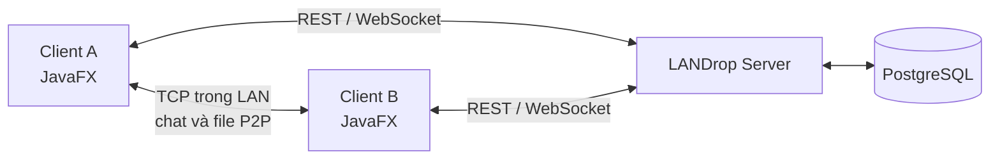

# LANDrop

**Chia sẻ file và cộng tác trong mạng nội bộ với ứng dụng desktop JavaFX.**

LANDrop kết hợp truyền file trực tiếp giữa các thiết bị trong LAN với một server quản lý tài khoản, thiết bị, workspace, chat nhóm và trạng thái kết nối. Đây là dự án đang phát triển, phù hợp để chạy và thử nghiệm trong môi trường tin cậy; các giới hạn trước khi triển khai thực tế được nêu ở [Trạng thái hiện tại](#trạng-thái-hiện-tại).

## Tổng quan

| Thành phần | Vai trò |
| --- | --- |
| **Client JavaFX** | Đăng nhập, chọn server, quản lý workspace, chat, file và phiên truyền tải. |
| **LANDrop Server** | Cung cấp REST API, WebSocket, xác thực, quản trị và dữ liệu dùng chung. |
| **LAN/P2P engine** | Tìm peer trong mạng nội bộ và truyền file qua kết nối TCP trực tiếp, có chia chunk và kiểm tra SHA-256. |
| **PostgreSQL** | Lưu tài khoản, phiên đăng nhập, thiết bị, workspace, tin nhắn và metadata file. |



Các chức năng đã có trong mã nguồn:

- **Tài khoản và thiết bị:** đăng ký, đăng nhập, làm mới phiên, đăng xuất, đăng ký thiết bị và ràng buộc kết nối realtime với phiên hợp lệ.
- **Workspace và chat nhóm:** tạo/quản lý workspace, thành viên và vai trò; kênh chat, lịch sử tin nhắn và sự kiện WebSocket.
- **File:** thư mục, metadata file, chia sẻ file trong chat, điều phối yêu cầu truyền và giao diện theo dõi truyền tải.
- **LAN/P2P:** discovery, chat trực tiếp, truyền file theo chunk, tiếp tục sau gián đoạn, tải từ nhiều peer, chuyển nguồn khi peer mất kết nối và xác minh SHA-256 trước khi hoàn tất file.
- **Quản trị server:** trang `/admin`, trạng thái server, cấu hình, tài khoản, thiết bị, workspace, phiên và nhật ký hoạt động.

> **Phạm vi:** Metadata và điều phối đi qua server; luồng file LAN sử dụng kết nối trực tiếp giữa các peer. Server không tự biến ứng dụng thành dịch vụ truyền file qua Internet.

## Bắt đầu nhanh

### Yêu cầu

- **JDK 21** và **Maven 3.9+**. Repo có Maven Wrapper (`mvnw` / `mvnw.cmd`) nếu chưa cài Maven toàn cục.
- **Node.js 20+** để dùng các lệnh `npm run ...` khởi chạy server và client. Các script này dùng Node built-in, không cần `npm install`.
- Một phiên desktop hỗ trợ JavaFX để mở client.
- **PostgreSQL** nếu cần đăng nhập, workspace, chat nhóm và dữ liệu lưu bền vững. Có thể chạy server ở chế độ LAN độc lập khi không cấu hình database, nhưng các chức năng cần tài khoản sẽ không khả dụng.

Trước khi khởi chạy **đầy đủ tính năng**, tạo một PostgreSQL database dành cho LANDrop, điền `DATABASE_URL`, `JWT_ACCESS_SECRET` và `JWT_REFRESH_SECRET` theo [.env.example](.env.example), rồi áp dụng migration:

```bash
mvn -pl backend compile exec:java "-Dexec.mainClass=com.landrop.database.DatabaseCli" "-Dexec.args=migrate"
```

Xem thêm [hướng dẫn database](docs/DATABASE.md). File `.env` chỉ dùng tại máy cá nhân và đã được Git bỏ qua. Không dùng URL database chứa dữ liệu thật khi chạy test.

Sau đó chạy các lệnh sau từ **thư mục gốc của repo**, trong các terminal riêng:

```bash
# Terminal 1: server và trang quản trị
npm run server

# Terminal 2: client JavaFX
npm run client
```

Server mặc định nghe HTTP tại `http://localhost:3000`, WebSocket tại `ws://localhost:3001/api/realtime`; trang quản trị ở `http://localhost:3000/admin`. Client mặc định kết nối tới `http://localhost:3000/api`, tự suy ra WebSocket tương ứng và vẫn mở màn hình cấu hình nếu server chưa sẵn sàng. Nhấn `Ctrl+C` tại terminal khởi chạy để đóng tiến trình.

### Chế độ chạy khác

| Lệnh | Công dụng |
| --- | --- |
| `npm run server` | Chuẩn bị backend, chạy server, kiểm tra `/health` và `/admin`, rồi mở trang quản trị. |
| `npm run server:backend` | Chạy backend nhưng không tự mở trang quản trị. |
| `npm run server:admin` | Mở trang quản trị của server đang chạy. |
| `npm run client` | Build các module cần thiết rồi mở JavaFX client. |
| `npm run client:ui` | Mở client bằng bản build hiện có. |
| `npm test` | Chạy test của các script Node khởi chạy. |

Có thể build Java trực tiếp bằng `mvn clean install`. Nếu dùng Maven Wrapper trên Windows, thay `mvn` bằng `.\mvnw.cmd`; trên macOS/Linux, dùng `./mvnw`.

Các script `start-discovery.*` và `start-peerA.*` đến `start-peerD.*` phục vụ luồng demo LAN với các cổng peer riêng (`5001`–`5004`, discovery `8888`). Chúng không thay cho `npm run server` khi cần đăng nhập và workspace. Xem [hướng dẫn demo P2P](docs/DEMO.md) để hiểu luồng discovery và truyền file trực tiếp.

## Cấu hình

Các giá trị trong bảng là mặc định khi không có cấu hình tương ứng. Xem [.env.example](.env.example) để biết đầy đủ các biến server và database.

| Biến | Mặc định | Ý nghĩa |
| --- | --- | --- |
| `HOST` / `PORT` | `0.0.0.0` / `3000` | Địa chỉ bind và cổng HTTP của server. |
| `WS_PORT` | `3001` | Cổng WebSocket của server. |
| `DATABASE_URL` | Không có | PostgreSQL cho tài khoản và dữ liệu dùng chung. |
| `LANDROP_API_URL` | `http://localhost:3000/api` | REST API mà client kết nối tới. |
| `LANDROP_WS_URL` | Tự suy ra từ API URL | WebSocket cho client; nên đặt rõ khi dùng cổng hoặc gateway khác mặc định. |
| `LANDROP_SESSION_PROFILE` | Profile mặc định | Tách phiên khi chạy nhiều client trên một máy. |

Client chỉ nhận các biến cấu hình phía client từ `.env` / `.env.local`; script server đọc các biến server để kiểm tra cấu hình. **Khi đổi cổng hoặc địa chỉ server, hãy đặt `HOST`, `PORT` và `WS_PORT` trong môi trường của terminal chạy `npm run server`** để tiến trình Java kế thừa cùng giá trị. Cập nhật `LANDROP_API_URL` và `LANDROP_WS_URL` của client cho khớp. Trên PowerShell, ví dụ:

```powershell
$env:PORT = '3100'
$env:WS_PORT = '3101'
$env:LANDROP_API_URL = 'http://localhost:3100/api'
$env:LANDROP_WS_URL = 'ws://localhost:3101/api/realtime'
```

Với nhiều client trên cùng máy, mỗi phiên P2P cần cổng riêng. Các tham số JavaFX `--peer-port`, `--display-name`, `--discovery-host`, `--discovery-port` và `--session-profile` hỗ trợ cấu hình từng phiên; các script peer có ví dụ sẵn.

## Build và kiểm thử

```bash
mvn clean install             # Build, chạy test và cài cả hai module vào Maven local
mvn test                      # Test mặc định của backend + frontend
mvn -pl backend test          # Chỉ test backend
mvn -pl frontend -am test     # Test frontend cùng dependency backend
npm test                      # Test các launcher Node
```

Nếu máy có `.env` trỏ tới database đang dùng, có thể chạy bộ regression không dùng database bằng lệnh sau:

```bash
mvn test "-Dlandrop.database.enabled=false" "-Dtest=*,!PersistentChatTest,!FileManagementTest" "-Dsurefire.failIfNoSpecifiedTests=false"
```

**Lưu ý về database khi test:** Mã backend tự tìm `DATABASE_URL` từ system property, biến môi trường hoặc `.env` ở thư mục hiện tại/thư mục cha. Một số test mặc định sẽ dùng database nếu có URL và có thể ghi dữ liệu; chỉ chạy chúng với database chuyên dụng cho kiểm thử. Các suite PostgreSQL opt-in khác cần `-Dlandrop.test.postgres=true`. Test JavaFX cần môi trường đồ họa; một số cổng kiểm thử LAN/live cần server ngoài và sẽ được bỏ qua nếu chưa cấu hình. Kế hoạch kiểm thử chi tiết nằm ở [docs/TEST_PLAN.md](docs/TEST_PLAN.md).

## Cấu trúc repo

```text
LANDrop/
├── backend/           TCP/P2P, discovery, REST, WebSocket, auth, database, admin
├── frontend/          JavaFX controllers, FXML, state services và API clients
├── prisma/            Mô tả schema PostgreSQL
├── docs/              Kiến trúc, hợp đồng API/protocol và kế hoạch test
├── scripts/           Launcher Node cho server và client, kèm test
├── .env.example       Mẫu cấu hình không chứa thông tin thật
├── pom.xml            Maven aggregator cho backend và frontend
└── package.json       Lệnh phát triển qua npm
```

Tài liệu kỹ thuật chính:

- [Kiến trúc P2P cốt lõi](docs/ARCHITECTURE.md) và [giao thức LAN](docs/PROTOCOL.md).
- [Hợp đồng client/server](docs/FOUNDATION-01B-CLIENT-CONTRACT.md), [xác thực server và đăng ký thiết bị](docs/FOUNDATION-04A-SERVER-AUTH.md), [xác thực client](docs/FOUNDATION-04B-CLIENT-AUTH.md), [quản trị](docs/FOUNDATION-03A-CONTROL-CENTER.md).
- [API chat nhóm](docs/PHASE-17A-API-CONTRACT.md), [API file và transfer](docs/PHASE-18A-API-CONTRACT.md), [database](docs/DATABASE.md).

## Trạng thái hiện tại

LANDrop có mã nguồn, migration, giao diện và test cho cả luồng LAN lẫn các tính năng dùng server. Đây **chưa phải bản triển khai production**: chưa có NAT traversal/relay để kết nối peer qua Internet; truyền TCP P2P cốt lõi chưa được mã hóa đầu cuối; một số tình huống cần kiểm thử thủ công trên nhiều thiết bị thật.

**Lưu ý bảo mật quan trọng:** Tài khoản quản trị hệ thống hiện được tạo/đồng bộ với thông tin đăng nhập cố định `admin` / `admin123` trong [`AdminBootstrapService`](backend/src/main/java/com/landrop/admin/security/AdminBootstrapService.java). Không đưa server ra Internet hoặc mạng không tin cậy với cơ chế này. Cần thay cơ chế khởi tạo và quản lý mật khẩu admin trước khi triển khai thực tế.

Một số tài liệu `CORE_*`, `FINAL_ACCEPTANCE.md` và `PRODUCTION_ROADMAP.md` ghi lại mốc P2P cũ; chúng không phản ánh đầy đủ phần xác thực, workspace, chat nhóm và quản trị đã được bổ sung sau đó. README này cùng mã nguồn và các hợp đồng API mới là điểm bắt đầu phù hợp để tìm hiểu trạng thái hiện tại.
