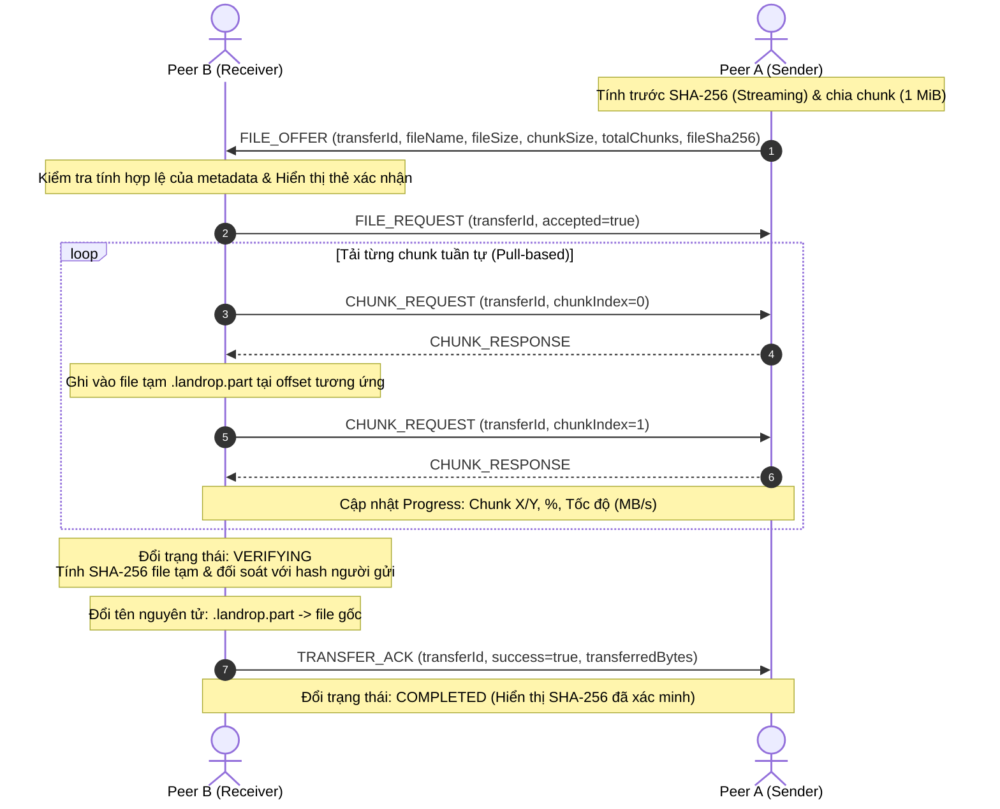
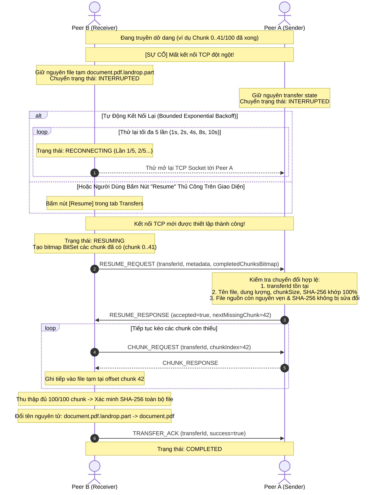
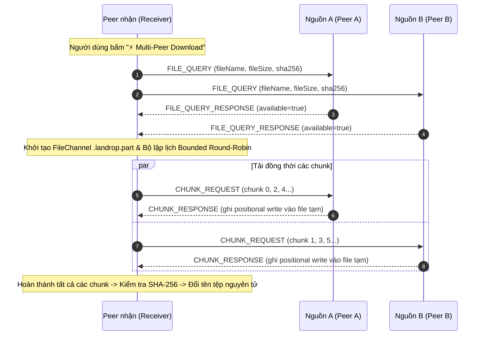

# LANDrop

A peer-to-peer (P2P) desktop application for local network file sharing and real-time messaging built with Java 21, JavaFX 21, and Maven multi-module architecture.

---

## 🚀 Hướng Dẫn Cách Chạy (Quick Start Guide)

### 1. Yêu cầu hệ thống
* **Java 21+** (JDK 21)
* **Apache Maven 3.9+**

### 2. Biên dịch dự án
Từ thư mục gốc `LANDrop`:
```bash
mvn clean install
```
*(Biên dịch và chạy kiểm thử toàn bộ 153 unit & integration tests trên cả `backend` (142 tests) và `frontend` (11 tests)).*

---

### 3. Nguyên Tắc Phân Bổ Cổng (Port Allocation)
Để tránh xung đột cổng `Address already in use`, hãy chạy các thành phần theo cấu hình cổng riêng biệt:

| Thành phần | Vai trò | Cổng sử dụng | Script macOS / Linux | Script Windows |
| :--- | :--- | :---: | :--- | :--- |
| **Discovery Server** | Đăng ký & phân giải peer nội mạng | **`8888`** | `./start-discovery.sh` | `start-discovery.bat` |
| **Peer A** | Desktop UI Client 1 | **`5001`** | `./start-peerA.sh` | `start-peerA.bat` |
| **Peer B** | Desktop UI Client 2 | **`5002`** | `./start-peerB.sh` | `start-peerB.bat` |

> [!IMPORTANT]
> * **Discovery Server** chỉ cần bật **1 cửa sổ duy nhất** trên cổng `8888`.
> * Mỗi Peer khi mở giao diện cần có **Local P2P Port khác nhau** (ví dụ Peer A dùng `5001`, Peer B dùng `5002`).

---

### 4. Cách Chạy Nhanh Bằng Script Tiện Ích (Khuyên dùng)

#### 🍎 4.1. Hướng Dẫn Trên macOS / Linux

Mở **3 cửa sổ Terminal riêng biệt** tại thư mục gốc `LANDrop`:

* **Terminal 1 (Discovery Server)**:
  ```bash
  cd /Users/theanhmac/Project/LANDrop
  ./start-discovery.sh
  ```
* **Terminal 2 (Peer A - Port 5001)**:
  ```bash
  ./start-peerA.sh
  ```
  *(Cửa sổ giao diện của Peer A sẽ xuất hiện)*
* **Terminal 3 (Peer B - Port 5002)**:
  ```bash
  ./start-peerB.sh
  ```
  *(Cửa sổ giao diện của Peer B sẽ xuất hiện)*

> [!TIP]
> Nếu chạy lần đầu báo lỗi `Permission denied`, hãy cấp quyền thực thi cho các file script:
> ```bash
> chmod +x start-discovery.sh start-peerA.sh start-peerB.sh
> ```

---

#### 🪟 4.2. Hướng Dẫn Trên Windows

Bạn có thể chạy bằng một trong hai cách cực kỳ thuận tiện sau:

##### Cách 1: Nhấp đúp chuột (Double-Click) trong File Explorer
Vào thư mục dự án `LANDrop`, nhấp đúp lần lượt 3 tệp sau:
1. Nhấp đúp **`start-discovery.bat`** $\rightarrow$ Cửa sổ Discovery Server màu đen mở lên lắng nghe tại cổng `8888`.
2. Nhấp đúp **`start-peerA.bat`** $\rightarrow$ Cửa sổ giao diện Peer A (Port 5001) mở lên.
3. Nhấp đúp **`start-peerB.bat`** $\rightarrow$ Cửa sổ giao diện Peer B (Port 5002) mở lên.

##### Cách 2: Chạy từ Command Prompt (CMD) hoặc PowerShell
Mở **3 cửa sổ CMD / PowerShell riêng biệt** tại thư mục `LANDrop`:
* **Cửa sổ 1 (Discovery Server)**:
  ```cmd
  start-discovery.bat
  ```
* **Cửa sổ 2 (Peer A - Port 5001)**:
  ```cmd
  start-peerA.bat
  ```
* **Cửa sổ 3 (Peer B - Port 5002)**:
  ```cmd
  start-peerB.bat
  ```

---

#### 🤝 Bắt Đầu Kết Nối & Trò Chuyện P2P Giữa Peer A và Peer B:
1. Trên cửa sổ **Peer A** và **Peer B**, bấm nút **"Connect & Join Network"** ở màn hình Setup để đăng ký vào Discovery Server.
2. Trên cửa sổ **Peer B**, bấm vào menu **Peers** ở thanh điều hướng bên trái.
3. Danh sách sẽ hiển thị **Peer A** (trạng thái Online tại `127.0.0.1:5001`).
4. Bấm nút **"Connect"** màu tím bên cạnh Peer A.
5. Màn hình sẽ tự động chuyển sang tab **Messages** $\rightarrow$ Bạn có thể gửi tin nhắn chat và truyền nhận file trực tiếp hai chiều giữa 2 cửa sổ!

---

### 5. Cách Chạy Trực Tiếp Bằng Lệnh Maven (Manual CLI)

Nếu không muốn dùng file script, bạn có thể gõ lệnh Maven trực tiếp từ thư mục gốc `LANDrop`:

#### 🍎 5.1. Dành cho macOS / Linux (Bash / Zsh)
* **Cửa sổ 1 (Discovery Server)**:
  ```bash
  mvn -pl backend exec:java -Dexec.mainClass="com.landrop.discovery.DiscoveryServer"
  ```
* **Cửa sổ 2 (Peer A)**:
  ```bash
  mvn -pl frontend javafx:run -Djavafx.args="--peer-port=5001 --display-name='Peer A'"
  ```
* **Cửa sổ 3 (Peer B)**:
  ```bash
  mvn -pl frontend javafx:run -Djavafx.args="--peer-port=5002 --display-name='Peer B'"
  ```

#### 🪟 5.2. Dành cho Windows Command Prompt (`cmd.exe`)
* **Cửa sổ 1 (Discovery Server)**:
  ```cmd
  mvn -pl backend exec:java -Dexec.mainClass="com.landrop.discovery.DiscoveryServer"
  ```
* **Cửa sổ 2 (Peer A)**:
  ```cmd
  mvn -pl frontend javafx:run -Djavafx.args="--peer-port=5001 --display-name=PeerA"
  ```
* **Cửa sổ 3 (Peer B)**:
  ```cmd
  mvn -pl frontend javafx:run -Djavafx.args="--peer-port=5002 --display-name=PeerB"
  ```

#### 🪟 5.3. Dành cho Windows PowerShell
Trong PowerShell, hãy bọc đối số trong cặp ngoặc kép để tránh bị phân tách ký tự:
* **Cửa sổ 1 (Discovery Server)**:
  ```powershell
  mvn -pl backend exec:java "-Dexec.mainClass=com.landrop.discovery.DiscoveryServer"
  ```
* **Cửa sổ 2 (Peer A)**:
  ```powershell
  mvn -pl frontend javafx:run "-Djavafx.args=--peer-port=5001 --display-name=PeerA"
  ```
* **Cửa sổ 3 (Peer B)**:
  ```powershell
  mvn -pl frontend javafx:run "-Djavafx.args=--peer-port=5002 --display-name=PeerB"
  ```

---

### 6. Cách Chạy Chế Độ Dòng Lệnh CLI (Terminal Chat Không Cần UI)
Nếu muốn chạy chat P2P dạng dòng lệnh nhẹ nhàng trong Terminal/Console:

* **Peer 1 (Server mode - Alice, Port 5001)**:
  * macOS / Linux:
    ```bash
    mvn -pl backend exec:java -Dexec.mainClass="com.landrop.chat.ChatCli" -Dexec.args="server 5001 Alice"
    ```
  * Windows (CMD / PowerShell):
    ```cmd
    mvn -pl backend exec:java -Dexec.mainClass="com.landrop.chat.ChatCli" -Dexec.args="server 5001 Alice"
    ```
* **Peer 2 (Client mode - Bob, kết nối tới Alice)**:
  * macOS / Linux:
    ```bash
    mvn -pl backend exec:java -Dexec.mainClass="com.landrop.chat.ChatCli" -Dexec.args="client localhost 5001 Bob"
    ```
  * Windows (CMD / PowerShell):
    ```cmd
    mvn -pl backend exec:java -Dexec.mainClass="com.landrop.chat.ChatCli" -Dexec.args="client localhost 5001 Bob"
    ```

---

### 7. Xử Lý Các Sự Cố Thường Gặp (Troubleshooting)

#### Lỗi 1: `Address already in use` hoặc `Port already bound`
* **Nguyên nhân**: Cổng `5001`, `5002` hoặc `8888` đang bị một tiến trình Java cũ chiếm giữ.
* **Cách khắc phục trên macOS / Linux**:
  ```bash
  kill -9 $(lsof -t -i:5001 -i:5002 -i:8888) 2>/dev/null
  ```
* **Cách khắc phục trên Windows**:
  * **Dùng PowerShell**:
    ```powershell
    Get-NetTCPConnection -LocalPort 5001, 5002, 8888 -ErrorAction SilentlyContinue | ForEach-Object { Stop-Process -Id $_.OwningProcess -Force }
    ```
  * **Dùng Command Prompt (CMD)**:
    Tìm PID tiến trình chiếm cổng (ví dụ cổng 8888):
    ```cmd
    netstat -ano | findstr :8888
    ```
    Sau đó tắt tiến trình bằng PID tìm được ở cột cuối cùng:
    ```cmd
    taskkill /F /PID <PID>
    ```

#### Lỗi 2: Cảnh báo tường lửa Windows (Windows Defender Firewall)
* **Hiện tượng**: Khi khởi động Discovery Server hoặc Peer trên Windows, xuất hiện thông báo *Windows Defender Firewall has blocked some features of this app*.
* **Cách khắc phục**: Nhấp chọn ô **Private networks (Mạng riêng tư)** và nhấn **Allow access** (Cho phép truy cập) để Java có quyền lắng nghe các kết nối TCP trong mạng cục bộ.

#### Lỗi 3: `Could not find the selected project in the reactor: frontend`
* **Nguyên nhân**: Terminal đang đứng bên trong thư mục `frontend/` nhưng lại gõ lệnh có cờ `-pl frontend`. Cờ `-pl` chỉ dùng khi đang ở thư mục gốc `LANDrop`.
* **Cách khắc phục**:
  * Nếu đang ở trong thư mục `frontend/`: chỉ cần gõ `mvn javafx:run ...`.
  * Hoặc gõ `cd ..` để quay về thư mục gốc `LANDrop` rồi chạy lệnh.

#### Lỗi 4: `No plugin found for prefix 'javafx'`
* **Cách khắc phục**: Đảm bảo bạn đã chạy `mvn clean install` một lần từ thư mục gốc để tải và cài đặt đầy đủ các plugin cần thiết.

---

### 8. Chuyển File P2P Phân Đoạn & Kiểm Tra Toàn Vẹn SHA-256 (Phase 7 Guide)

LANDrop hỗ trợ truyền file phân đoạn (Chunk-based) tuần tự, kiểm tra tính toàn vẹn bằng mã băm SHA-256 dạng streaming trực tiếp giữa 2 peer:



#### Cấu Trúc Các Gói Tin Điều Khiển & Dữ Liệu (Packet Layouts):
1. **`FILE_OFFER` (Code 5, JSON)**:
   ```json
   {
     "transferId": "41a996f0-4fa8-4b71-9ce1-8dfb8417c805",
     "fileName": "document.pdf",
     "fileSize": 10485760,
     "senderPeerId": "peer-a-uuid",
     "senderDisplayName": "Peer A",
     "chunkSize": 1048576,
     "totalChunks": 10,
     "fileSha256": "ba7816bf8f01cfea414140de5dae2223b00361a396177a9cb410ff61f20015ad"
   }
   ```
2. **`FILE_REQUEST` (Code 6, JSON)**:
   `{"transferId": "...", "accepted": true, "reason": ""}`
3. **`CHUNK_REQUEST` (Code 7, JSON)**:
   `{"transferId": "...", "chunkIndex": 0}`
4. **`CHUNK_RESPONSE` (Code 8, Binary Framing)**:
   `[1B transferIdLen][N bytes transferId][4B chunkIndex (int)][4B chunkLength (int)][M bytes chunkData]`
5. **`TRANSFER_ACK` (Code 9, JSON)**:
   `{"transferId": "...", "success": true, "transferredBytes": 10485760, "message": "Transfer completed successfully"}`

#### Các tính năng an toàn & độ tin cậy cốt lõi (Core Safety & Integrity):
* **Kiểm tra tính toàn vẹn SHA-256 (Streaming Hash)**:
  * Người gửi tính hash toàn bộ file trước khi phát thông điệp `FILE_OFFER`.
  * Người nhận sau khi thu thập đủ tất cả các chunk sẽ tính lại SHA-256 của file tạm. Nếu mã băm khớp 100%, file mới được xác nhận hợp lệ.
  * Nếu mã băm không khớp, file tạm lập tức bị xóa bỏ và chuyển trạng thái sang `FAILED`.
  * Quá trình băm chạy luồng ảo (`Virtual Thread`) với bộ đệm luồng, không nạp toàn bộ file vào RAM $\rightarrow$ an toàn với file nhiều GB.
* **Tập tin tạm (`.landrop.part`) & Đổi tên nguyên tử (`Atomic Move`)**:
  * Dữ liệu đang nhận được ghi trực tiếp vào `filename.landrop.part`.
  * Chỉ khi xác minh SHA-256 thành công, file mới được đổi tên nguyên tử thành tên tệp chính thức, không để lộ tệp tải dở dang.
* **Chống gói tin trùng lặp (`BitSet De-duplication`)**:
  * Người nhận theo dõi các chunk đã nhận qua cấu trúc `BitSet`, bỏ qua các gói tin trùng lặp mà không gây sai lệch dữ liệu.
* **Kiểm tra tính nhất quán tệp nguồn (Sender Consistency Check)**:
  * Người gửi kiểm tra dung lượng và sự tồn tại của tệp nguồn trước khi đọc từng chunk, phát hiện kịp thời nếu file bị can thiệp giữa chừng.
* **Hỗ trợ tệp 0-byte**:
  * Tệp rỗng (0 byte) được xử lý trực tiếp (`totalChunks = 0`), tính mã băm chuẩn của tệp rỗng và hoàn tất ngay lập tức mà không cần gửi `CHUNK_REQUEST`.
* **Trò chuyện song song không ngắt quãng**:
  * Các gói tin `CHAT_MESSAGE` và `PING`/`PONG` được xen kẽ nhịp nhàng trên cùng kết nối TCP nhờ cơ chế khóa ghi luồng an toàn (`writeLock`).

---

### 9. Khôi Phục Truyền File Gián Đoạn & Thử Lại Từng Chunk (Phase 8 Guide)

Khi kết nối mạng P2P bị chập chờn hoặc ngắt kết nối đột ngột giữa chừng, LANDrop tự động bảo lưu tiến trình truyền nhận và hỗ trợ khôi phục tiếp tục (Resume) mà không cần truyền lại từ đầu:



#### Cấu Trúc Gói Tin Bổ Sung Trong Phase 8:
1. **`RESUME_REQUEST` (Code 18, JSON)**:
   ```json
   {
     "transferId": "41a996f0-4fa8-4b71-9ce1-8dfb8417c805",
     "fileName": "document.pdf",
     "fileSize": 104857600,
     "chunkSize": 1048576,
     "totalChunks": 100,
     "fileSha256": "ba7816bf8f01cfea414140de5dae2223b00361a396177a9cb410ff61f20015ad",
     "completedChunksBitmap": "//////8="
   }
   ```
2. **`RESUME_RESPONSE` (Code 19, JSON)**:
   ```json
   {
     "transferId": "41a996f0-4fa8-4b71-9ce1-8dfb8417c805",
     "accepted": true,
     "nextMissingChunk": 42,
     "reason": ""
   }
   ```

#### Các Cơ Chế Đảm Bảo Khôi Phục An Toàn & Chống Lỗi:
* **Không Xóa File Tạm Khi Mất Kết Nối**:
  * Khi socket đứt gãy, `FileTransferService` lập tức flush kênh ghi file và chuyển sang `INTERRUPTED`. File `.landrop.part` được giữ nguyên vẹn trên đĩa.
* **Chiến Lược Kết Nối Lại Có Giới Hạn (Bounded Backoff Reconnect)**:
  * Tối đa `MAX_RECONNECT_ATTEMPTS = 5` lần với thời gian chờ giãn cách lũy tiến: `1s, 2s, 4s, 8s, 10s`.
  * Nếu sau 5 lần vẫn không kết nối được, tiến trình mới chuyển sang `FAILED` kèm thông báo lỗi rõ ràng.
* **Bắt Tay Khôi Phục Chặt Chẽ (Two-way Resume Handshake)**:
  * Bên gửi đối soát nghiêm ngặt: tên file, kích thước file, kích thước chunk, số lượng chunk, và mã băm SHA-256 dự kiến.
  * Bên gửi băm lại file nguồn trên đĩa để đảm bảo nội dung tệp nguồn không bị chỉnh sửa hay thay thế trong lúc mất kết nối (`SOURCE_FILE_CHANGED`).
* **Thử Lại Từng Chunk Khi Timeout (Per-Chunk Retry)**:
  * Mỗi chunk có timeout độc lập (mặc định 5s).
  * Nếu một chunk bị thất lạc gói hoặc timeout, client tự động thử lại tối đa `MAX_CHUNK_RETRIES = 3` lần cho chính chunk đó mà không làm đứt toàn bộ file transfer.
* **Giao Diện Trực Quan (Dynamic UI Status)**:
  * Tab **Transfers** và bong bóng chat hiển thị rõ các trạng thái `Interrupted`, `Reconnecting (Attempt 2/5)`, `Resuming...`, `Retrying chunk 42 (Attempt 2/3)`.
  * Hỗ trợ 2 nút hành động trực tiếp: **"Resume"** (kết nối lại và gửi yêu cầu tiếp tục) và **"Cancel"** (hủy bỏ hoàn toàn và dọn dẹp file tạm).

---

### 10. Tải File Đa Nguồn Song Song (Phase 9 — Multi-Peer Swarm Guide)

LANDrop cho phép một Peer nhận tải các đoạn khác nhau của cùng một tệp từ **nhiều Peer nguồn cùng lúc** (Swarm Transfer) qua các kết nối TCP trực tiếp độc lập:



#### Hướng dẫn kích hoạt từ giao diện Desktop:
1. Vào tab **Transfers** ở thanh menu bên trái.
2. Bấm nút **"⚡ Multi-Peer Download"** ở thanh tiêu đề góc trên bên phải.
3. Điền các thông số tệp cần tải:
   - **File Name**: Tên tệp muốn lưu (ví dụ: `ubuntu-24.04.iso`).
   - **File Size (bytes)**: Dung lượng tệp chính xác (ví dụ: `104857600`).
   - **Expected SHA-256**: Mã hash SHA-256 kiểm tra tính toàn vẹn (64 ký tự hex).
4. Nhấn **"Start Download"**:
   - Ứng dụng tự động phát gói `FILE_QUERY` đến các Peer đang trực tuyến.
   - Các Peer có tệp sẽ gửi phản hồi xác nhận và tham gia Swarm.
   - Hàng tải đa nguồn xuất hiện với biểu đồ tốc độ gộp, thời gian còn lại (ETA) và số lượng chunk đóng góp của từng Peer (ví dụ: `Peer A: 8 chunks (8 MB)`, `Peer B: 8 chunks (8 MB)`).
   - Tự động chuyển giao chunk (Failover) nếu một Peer trong Swarm bị ngắt kết nối giữa chừng.

---

## 📁 Cấu Trúc Dự Án (Project Structure)

```text
LANDrop/
├── pom.xml                 # Root Maven Aggregator POM
├── README.md               # Tài liệu hướng dẫn dự án (Mac & Windows)
├── docs/
│   └── PHASE-9.md          # Đặc tả chi tiết kiến trúc Phase 9 Multi-Peer
│
├── start-discovery.sh      # Script bật Discovery Server cho macOS/Linux (Port 8888)
├── start-peerA.sh          # Script bật Peer A UI cho macOS/Linux (Port 5001)
├── start-peerB.sh          # Script bật Peer B UI cho macOS/Linux (Port 5002)
├── start-discovery.bat     # Script bật Discovery Server cho Windows (Port 8888)
├── start-peerA.bat         # Script bật Peer A UI cho Windows (Port 5001)
├── start-peerB.bat         # Script bật Peer B UI cho Windows (Port 5002)
│
├── backend/                # Module Backend (P2P Core & Networking Engine)
│   ├── pom.xml
│   ├── README.md
│   └── src/main/java/com/landrop/
│       ├── network/        # TCP raw socket Server & Client
│       ├── protocol/       # Binary TCP Packet, Framing, Encoder, Decoder (V1)
│       ├── peer/           # PeerConnection, PeerListener, Handshake
│       ├── chat/           # ChatService, ChatMessage, ChatCli
│       ├── discovery/      # DiscoveryServer, DiscoveryClient, PeerRegistry
│       └── transfer/       # FileTransferService, ChunkManager, ChunkScheduler, MultiPeerDownloadCoordinator
│
└── frontend/               # Module Frontend (JavaFX Desktop UI)
    ├── pom.xml
    └── src/main/
        ├── java/com/landrop/ui/
        │   ├── MainApp.java           # JavaFX Application Entry Point
        │   ├── controllers/           # Setup, Main, Dashboard, Peers, Chat, Transfers, Settings
        │   ├── models/                # UI Data models & Observable properties
        │   ├── services/              # UIStateService (Bridge Network & JavaFX Thread)
        │   └── utils/                 # AlertUtils, UI Helpers
        └── resources/com/landrop/ui/
            ├── *.fxml                 # Giao diện FXML (Setup, Main, Peers, Chat, Transfers...)
            └── styles.css             # Theme màu sáng hiện đại (Indigo/Slate)
```

---

## 🧩 Tiến Độ Các Phase

* [x] **Phase 1**: TCP Socket Communication (PeerServer / PeerClient)
* [x] **Phase 2**: Custom Binary TCP Protocol (Packet, Encoder, Decoder, Framing, RequestID)
* [x] **Phase 3**: Real-time Bidirectional Chat (ChatService, Async Reader, ChatCli, `/ping`, `/help`, `/quit`)
* [x] **Phase 4**: Centralized Discovery Server (PeerRegistry, Heartbeat, Timeout Eviction, DiscoveryClient)
* [x] **Phase 5**: JavaFX Desktop User Interface (Modern Light Theme, Setup Screen, Dashboard, Peer Discovery View, Real-time Chat UI)
* [x] **Phase 6**: Basic P2P File Transfer (Direct TCP Streaming, 64KB NIO Chunks, Safe Path Resolution, In-Chat Transfer Cards, Transfers History View)
* [x] **Phase 7**: Chunked P2P File Transfer + SHA-256 Integrity Verification (Sequential 1 MiB Chunk Streaming, CHUNK_REQUEST/RESPONSE, Streaming SHA-256 Verification, Partial Files .part, BitSet De-duplication)
* [x] **Phase 8**: P2P File Transfer Resume + Retry (Session-level Interruption Handling, Bounded Exponential Backoff Reconnection, Two-way Resume Handshake, BitSet Chunk Bitmap, Per-Chunk Retry & Timeout, UI Controls)
* [x] **Phase 9**: Multi-Peer Parallel Swarming File Transfer (Direct TCP multi-source downloads, Bounded Round-Robin Chunk Scheduling, Concurrent positional FileChannel writes, Dynamic late-peer joins, Failover recovery, Aggregated UI metrics)
* [ ] **Phase 10**: End-to-End Encryption (TLS / AES-GCM)
* [ ] **Phase 11**: Persistent Transfer State Database (SQLite)

