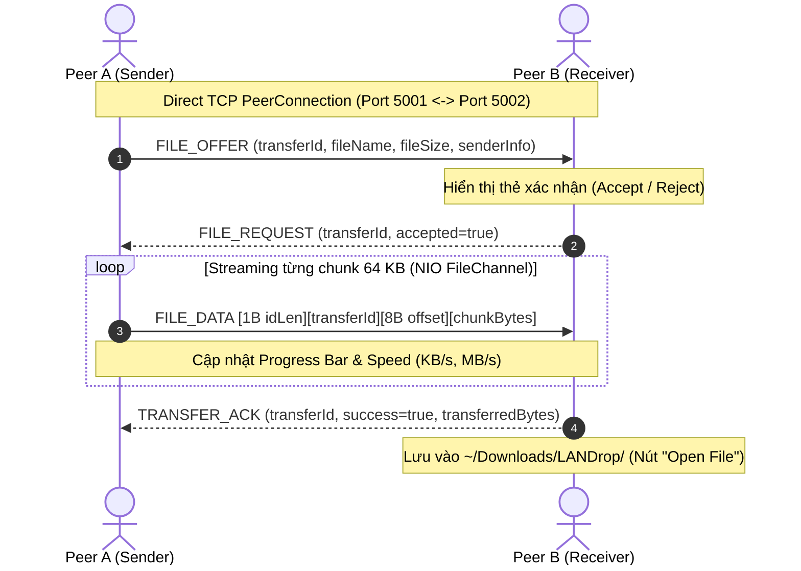

# LANDrop

A peer-to-peer (P2P) desktop application for local network file sharing and real-time messaging built with Java 21, JavaFX 21, and Maven multi-module architecture.

---

## 🚀 Hướng Dẫn Cách Chạy (Quick Start Guide)

### 1. Yêu cầu hệ thống
* **Java 21+** (JDK 21)
* **Apache Maven 3.9+**

### 2. Biên dịch dự án
Từ thư mục gốc `LANDrop`:
```bash
mvn clean install
```
*(Biên dịch và chạy kiểm thử toàn bộ 92 unit & integration tests trên cả `backend` (82 tests) và `frontend` (10 tests)).*

---

### 3. Nguyên Tắc Phân Bổ Cổng (Port Allocation)
Để tránh xung đột cổng `Address already in use`, hãy chạy các thành phần theo cấu hình cổng riêng biệt:

| Thành phần | Vai trò | Cổng sử dụng | Lệnh / Script |
| :--- | :--- | :---: | :--- |
| **Discovery Server** | Đăng ký & phân giải peer nội mạng | **`8888`** | `./start-discovery.sh` |
| **Peer A** | Desktop UI Client 1 | **`5001`** | `./start-peerA.sh` |
| **Peer B** | Desktop UI Client 2 | **`5002`** | `./start-peerB.sh` |

> [!IMPORTANT]
> * **Discovery Server** chỉ cần bật **1 cửa sổ duy nhất** trên cổng `8888`.
> * Mỗi Peer khi mở giao diện cần có **Local P2P Port khác nhau** (ví dụ Peer A dùng `5001`, Peer B dùng `5002`).

---

### 4. Cách Chạy Nhanh Bằng Script Tiện Ích (Khuyên dùng)

Mở **3 cửa sổ Terminal riêng biệt** tại thư mục gốc `/Users/theanhmac/Project/LANDrop`:

#### Terminal 1: Khởi động Discovery Server
```bash
cd /Users/theanhmac/Project/LANDrop
./start-discovery.sh
```
> Server sẽ lắng nghe tại cổng `8888`:
> ```text
> Starting LANDrop Discovery Server on port 8888...
> =================================
> LANDrop - Discovery Server
> =================================
> Discovery server started.
> Waiting for peers...
> ```

#### Terminal 2: Khởi động Peer A (Port 5001)
```bash
cd /Users/theanhmac/Project/LANDrop
./start-peerA.sh
```
1. Cửa sổ **LANDrop Setup** mở lên với cấu hình mặc định:
   - **Display Name**: `Peer A`
   - **Local P2P Port**: `5001`
   - **Discovery Server**: `localhost:8888`
2. Bấm nút **"Connect & Join Network"** $\rightarrow$ Hệ thống đăng ký vào Discovery và mở Dashboard chính.

#### Terminal 3: Khởi động Peer B (Port 5002)
```bash
cd /Users/theanhmac/Project/LANDrop
./start-peerB.sh
```
1. Cửa sổ **LANDrop Setup** mở lên với cấu hình mặc định:
   - **Display Name**: `Peer B`
   - **Local P2P Port**: `5002`
   - **Discovery Server**: `localhost:8888`
2. Bấm nút **"Connect & Join Network"** $\rightarrow$ Mở Dashboard chính của Peer B.

#### Bắt đầu Chat P2P giữa Peer A và Peer B:
1. Trên cửa sổ **Peer B**, bấm vào menu **Peers** ở thanh điều hướng bên trái.
2. Danh sách sẽ hiển thị **Peer A** (trạng thái Online tại `127.0.0.1:5001`).
3. Bấm nút **"Connect"** màu tím bên cạnh Peer A.
4. Màn hình sẽ tự động chuyển sang tab **Messages** $\rightarrow$ Bạn có thể gửi tin nhắn qua lại tức thì hai chiều giữa 2 cửa sổ!

---

### 5. Cách Chạy Trực Tiếp Bằng Lệnh Maven

#### A. Khi đang đứng tại thư mục gốc `LANDrop`:
* **Discovery Server**:
  ```bash
  mvn -pl backend exec:java -Dexec.mainClass="com.landrop.discovery.DiscoveryServer"
  ```
* **Peer A (Port 5001)**:
  ```bash
  mvn -pl frontend javafx:run -Djavafx.args="--peer-port=5001 --display-name=PeerA"
  ```
* **Peer B (Port 5002)**:
  ```bash
  mvn -pl frontend javafx:run -Djavafx.args="--peer-port=5002 --display-name=PeerB"
  ```

#### B. Khi đang đứng bên trong thư mục con:
* **Từ thư mục `backend/`**:
  ```bash
  cd backend
  mvn exec:java -Dexec.mainClass="com.landrop.discovery.DiscoveryServer"
  ```
* **Từ thư mục `frontend/`**:
  ```bash
  cd frontend
  # Lưu ý: KHÔNG dùng cờ -pl frontend khi đã ở bên trong thư mục frontend/
  mvn javafx:run -Djavafx.args="--peer-port=5001 --display-name=PeerA"
  ```

---

### 6. Cách Chạy Chế Độ Dòng Lệnh CLI (Terminal Chat)
Nếu muốn chạy chat P2P không cần giao diện đồ họa:

* **Peer 1 (Server mode - Alice, Port 5001)**:
  ```bash
  mvn -pl backend exec:java -Dexec.mainClass="com.landrop.chat.ChatCli" -Dexec.args="server 5001 Alice"
  ```
* **Peer 2 (Client mode - Bob, kết nối tới Alice)**:
  ```bash
  mvn -pl backend exec:java -Dexec.mainClass="com.landrop.chat.ChatCli" -Dexec.args="client localhost 5001 Bob"
  ```

---

### 7. Xử Lý Các Sự Cố Thường Gặp (Troubleshooting)

#### Lỗi 1: `Address already in use`
* **Nguyên nhân**: Cổng `5001`, `5002` hoặc `8888` đang bị một tiến trình Java cũ chiếm giữ.
* **Cách khắc phục**: Chạy lệnh sau trong Terminal để giải phóng toàn bộ các cổng này:
  ```bash
  kill -9 $(lsof -t -i:5001 -i:5002 -i:8888) 2>/dev/null
  ```

#### Lỗi 2: `Could not find the selected project in the reactor: frontend`
* **Nguyên nhân**: Terminal đang đứng bên trong thư mục `frontend/` nhưng lại gõ lệnh có cờ `-pl frontend`. Cờ `-pl` chỉ hoạt động từ thư mục gốc.
* **Cách khắc phục**:
  * Nếu đang ở trong `frontend/`: bỏ `-pl frontend`, chỉ cần gõ `mvn javafx:run ...`.
  * Hoặc gõ `cd ..` để trở về thư mục gốc `LANDrop` rồi chạy lệnh.

#### Lỗi 3: `No plugin found for prefix 'javafx'`
* **Cách khắc phục**: Plugin JavaFX đã được cấu hình trong `<pluginManagement>` của root `pom.xml`. Hãy đảm bảo bạn đã chạy `mvn clean install` từ thư mục gốc một lần để cập nhật.

---

### 8. Chuyển File P2P Trực Tiếp (Phase 6 - P2P File Transfer Guide)

LANDrop hỗ trợ gửi file trực tiếp giữa 2 peer qua kết nối TCP riêng biệt mà không thông qua bất kỳ server trung gian hay cloud nào:



#### Các bước chuyển file trên giao diện Desktop UI:
1. Đảm bảo **Peer A** và **Peer B** đã kết nối với nhau (đang ở màn hình **Messages**).
2. Tại khung chat, bấm nút kẹp giấy **📎** ở cạnh ô nhập tin nhắn.
3. Chọn file bất kỳ từ máy tính (hỗ trợ mọi định dạng, file rỗng 0-byte, file dung lượng lớn nhiều GB).
4. Phía người gửi: xuất hiện thẻ file đang ở trạng thái *"Waiting for receiver to accept..."*.
5. Phía người nhận: xuất hiện thẻ file với 2 nút tương tác **"Accept"** và **"Reject"**.
   - Bấm **"Reject"**: Huỷ chuyển, thông báo từ chối cho người gửi.
   - Bấm **"Accept"**: Bắt đầu truyền dữ liệu trực tiếp tức thì qua kênh TCP!
6. Thanh tiến trình (Progress Bar), phần trăm (%), dung lượng đã truyền (`transferred / total`), tốc độ truyền (`KB/s` hoặc `MB/s`), và nút **"Cancel"** được cập nhật trực quan thời gian thực.
7. **Trò chuyện song song không gián đoạn**: Trong lúc file đang truyền, bạn vẫn có thể gõ tin nhắn chat văn bản và `/ping` bình thường mà không bị block.
8. Khi hoàn tất:
   - File được lưu an toàn tại: `~/Downloads/LANDrop/<fileName>`.
   - Bấm nút **"Open File"** để mở trực tiếp file hoặc thư mục đích.
9. Quản lý lịch sử truyền file: Bấm vào tab **Transfers** (📁) ở thanh điều hướng bên trái để theo dõi tổng số file, file đang truyền, file đã hoàn tất và kích thước/tốc độ của từng file.

#### Cơ chế An toàn & Độ tin cậy (Security & Reliability):
* **Chống Path Traversal**: Tên file được chuẩn hóa bỏ các ký tự độc hại, thư mục cha (`../`), và kiểm tra containment nghiêm ngặt trong thư mục lưu trữ.
* **Tự động xử lý trùng tên**: Nếu file đã tồn tại ở máy nhận, hệ thống tự động đổi tên dạng `document (1).pdf`, `document (2).pdf` thay vì ghi đè.
* **Bộ đệm an toàn (64 KB Chunks)**: Sử dụng Java NIO `FileChannel` đọc/ghi tuần tự, không bao giờ nạp toàn bộ file vào RAM, tránh hiện tượng `OutOfMemoryError`.
* **Phân tách luồng không block**: Tiến trình gửi/nhận chạy trên Virtual Thread độc lập; luồng đọc gói tin TCP được điều phối không làm chậm các gói `CHAT_MESSAGE`.

---

## 📁 Cấu Trúc Dự Án (Project Structure)

```text
LANDrop/
├── pom.xml                 # Root Maven Aggregator POM
├── README.md               # Tài liệu hướng dẫn dự án
├── start-discovery.sh      # Script bật Discovery Server (Port 8888)
├── start-peerA.sh          # Script bật Peer A UI (Port 5001)
├── start-peerB.sh          # Script bật Peer B UI (Port 5002)
│
├── backend/                # Module Backend (P2P Core & Networking Engine)
│   ├── pom.xml
│   ├── README.md
│   └── src/main/java/com/landrop/
│       ├── network/        # TCP raw socket Server & Client
│       ├── protocol/       # Binary TCP Packet, Framing, Encoder, Decoder (V1)
│       ├── peer/           # PeerConnection, PeerListener, Handshake
│       ├── chat/           # ChatService, ChatMessage, ChatCli
│       ├── discovery/      # DiscoveryServer, DiscoveryClient, PeerRegistry
│       └── transfer/       # FileTransferService, FileDataChunk, Messages, Utils
│
└── frontend/               # Module Frontend (JavaFX Desktop UI)
    ├── pom.xml
    └── src/main/
        ├── java/com/landrop/ui/
        │   ├── MainApp.java           # JavaFX Application Entry Point
        │   ├── controllers/           # Setup, Main, Dashboard, Peers, Chat, Transfers, Settings
        │   ├── models/                # UI Data models & Observable properties
        │   ├── services/              # UIStateService (Bridge Network & JavaFX Thread)
        │   └── utils/                 # AlertUtils, UI Helpers
        └── resources/com/landrop/ui/
            ├── *.fxml                 # Giao diện FXML (Setup, Main, Peers, Chat, Transfers...)
            └── styles.css             # Theme màu sáng hiện đại (Indigo/Slate)
```

---

## 🧩 Tiến Độ Các Phase

* [x] **Phase 1**: TCP Socket Communication (PeerServer / PeerClient)
* [x] **Phase 2**: Custom Binary TCP Protocol (Packet, Encoder, Decoder, Framing, RequestID)
* [x] **Phase 3**: Real-time Bidirectional Chat (ChatService, Async Reader, ChatCli, `/ping`, `/help`, `/quit`)
* [x] **Phase 4**: Centralized Discovery Server (PeerRegistry, Heartbeat, Timeout Eviction, DiscoveryClient)
* [x] **Phase 5**: JavaFX Desktop User Interface (Modern Light Theme, Setup Screen, Dashboard, Peer Discovery View, Real-time Chat UI)
* [x] **Phase 6**: Basic P2P File Transfer (Direct TCP Streaming, 64KB NIO Chunks, Safe Path Resolution, In-Chat Transfer Cards, Transfers History View)
* [ ] **Phase 7**: Advanced Transfer Features (Chunk-level Checksums, Resume/Retry, Multi-peer Sharing - Giai đoạn tiếp theo)
