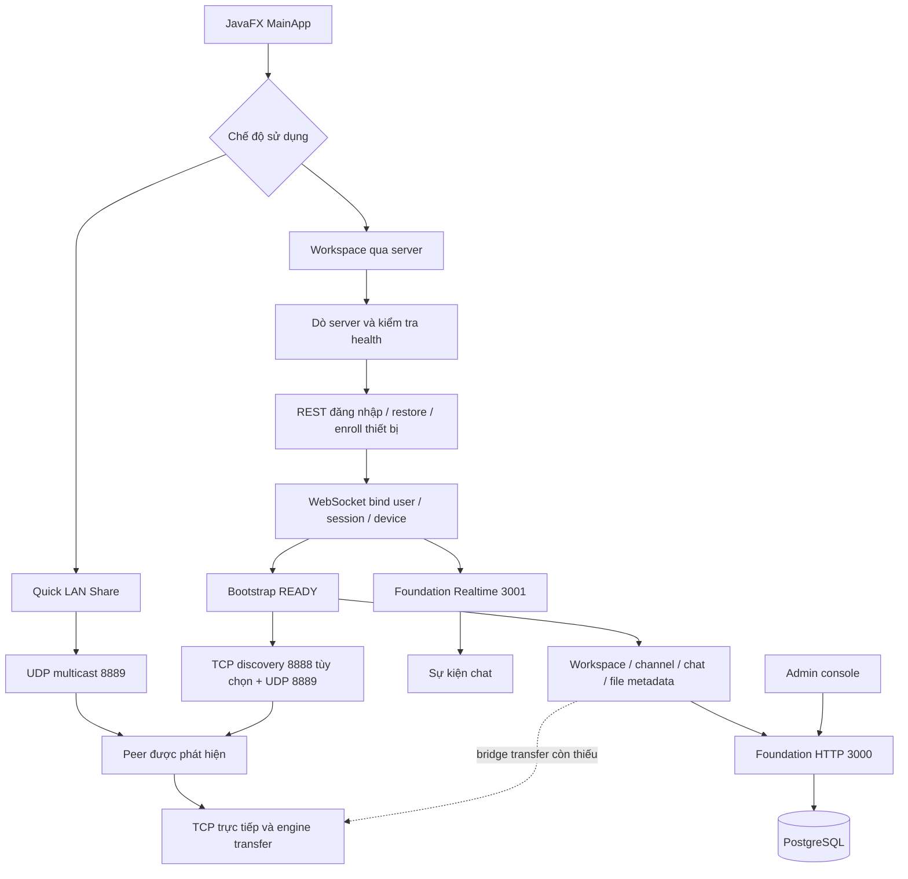
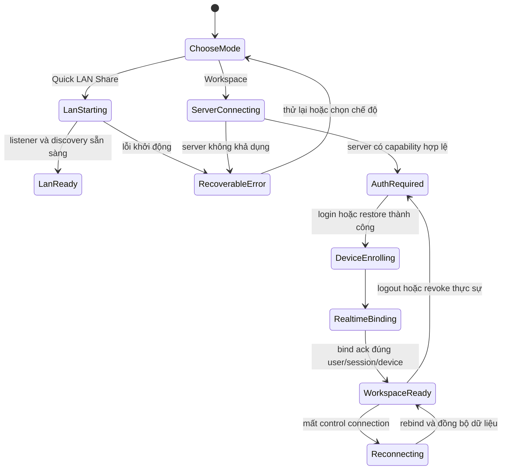
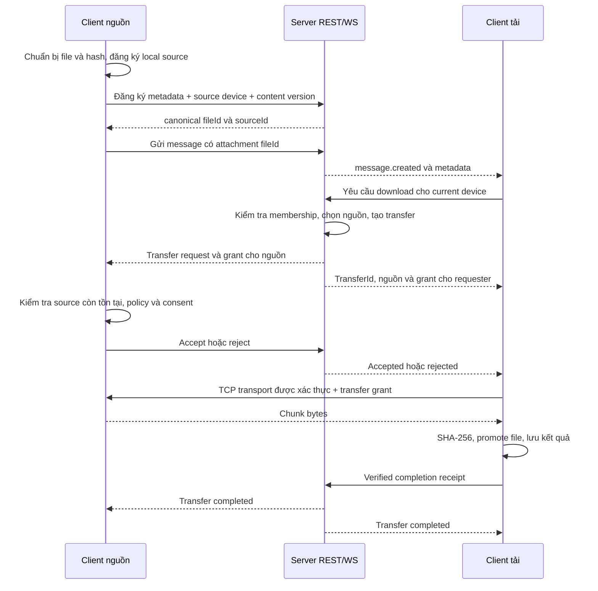

# LANDrop — Rà soát flow và kế hoạch nâng cấp

Ngày rà soát: **03/10/2026**. Phạm vi: mã nguồn trong working tree, hai module Maven, FXML, các entrypoint, API/WS, database/migration, test và script đóng gói/khởi động.

Đây là đánh giá từ mã nguồn và các kiểm tra ghi ở mục 8; các nhận định cần kiểm thử end-to-end được đánh dấu riêng. Working tree có thay đổi P2P encryption và ZIP đang diễn ra trong lúc rà soát; kết quả build là kết quả tại thời điểm chạy, không phải chứng nhận cho mọi thay đổi sau đó. Việc rà soát chỉ bổ sung tài liệu, không sửa mã ứng dụng hay những thay đổi đang có.

## 1. Kết luận và phạm vi sản phẩm

**Kiến trúc tổng thể hợp lý; các flow tích hợp chưa hoàn chỉnh.** Việc dùng server cho tài khoản, quyền, chat và metadata, còn file bytes đi trực tiếp trong LAN, phù hợp với mục tiêu dự án. Quick LAN Share độc lập cũng là một hướng sử dụng hữu ích. Không cần viết lại engine hoặc chuyển sang microservices để giải quyết các vấn đề hiện tại.

Điểm cần xử lý trước là **đường nối giữa các thành phần**: file trong chat chưa có danh tính metadata thật, điều phối REST/WS bị tách đôi, chưa có bridge từ yêu cầu workspace đến P2P, và một số trạng thái UI báo thành công sớm. Ngoài ra, có rủi ro phiên đăng nhập khi refresh token, quyền đọc file qua P2P và khả năng khởi động server trên database mới.

Phạm vi đề xuất cho bản tiếp theo:

- **Quick LAN Share:** không cần tài khoản/server; discovery, ghép thiết bị, chat trực tiếp, gửi file/thư mục, quản lý transfer.
- **Workspace trong LAN:** đăng nhập, thiết bị, nhóm/kênh/thành viên, chat bền vững, đăng ký file, tải từ thiết bị nguồn đang khả dụng.
- **File LAN_ONLY:** metadata lưu trên server; nội dung còn nằm trên thiết bị nguồn. Kho tài liệu phải diễn đạt rõ điều này, vì nguồn offline đồng nghĩa có thể không tải được.
- Internet/NAT relay, cloud object storage, mobile và clustering là các hướng sau khi bản LAN vượt qua nghiệm thu.

Tài liệu này thay thế thứ tự ưu tiên của [plan Group Chat & Large File Sharing](PLAN_GROUP_CHAT_LARGE_FILE_SHARING.md). [Production Roadmap](PRODUCTION_ROADMAP.md) vẫn là tầm nhìn dài hạn. [Expansion Status](EXPANSION_STATUS.md), [Architecture](ARCHITECTURE.md) và [Test Plan](TEST_PLAN.md) cần được cập nhật theo từng milestone; các nhãn PASS hoặc mô tả plaintext trong tài liệu cũ không đủ để kết luận trạng thái working tree hiện tại.

## 2. Bản đồ hệ thống đang có

Các cổng trên là mặc định; HTTP/WS/P2P có cấu hình. TCP discovery nhúng trong server hiện dùng cứng 8888.

| Flow | Chuỗi xử lý hiện tại | Đánh giá |
| --- | --- | --- |
| Server start | `LandropServerMain` → `ServerConfig` → DB connectivity → dựng auth/device/workspace/chat/file/admin → HTTP → Foundation WS → discovery → shutdown hook | Có composition root; thiếu readiness theo capability, migration trong startup và rollback khi startup lỗi giữa chừng. |
| Client start | `MainApp` → profile/instance/config/session store → server discovery → health → restore/login → enroll device → authenticated WS → READY → mount feature services → LAN runtime | Thứ tự auth/enroll/bind tốt; runtime LAN lỗi vẫn có thể mở dashboard; còn thiếu chính sách chuyển chế độ và vòng đời thống nhất. |
| Offline LAN | `--offline=true` hoặc nút offline → TCP listener → FileTransferService → UDP multicast → Peers/Direct Messages | Có flow độc lập. Cần chỉ rõ các capability và xử lý dọn tài nguyên khi khởi động một phần thất bại. |
| Discovery | Server được tìm bằng URL ưu tiên, localhost, IP máy, quét subnet; peer được tìm qua registry TCP và UDP beacon | Tách server discovery với peer discovery hợp lý; URL HTTPS/path và WS port thực tế chưa được bảo toàn khi probe server. |
| Auth/session | Login/register → `/auth/me` → JWT/session; HTTP 401 → refresh dùng một request chung; logout/revoke dọn client | Có nhiều kiểm tra session/device. Cần xử lý refresh token rotation cùng WS; property JavaFX cũng cần cập nhật qua FX thread. |
| Device identity | Profile → clientInstanceId → device enrollment → server deviceId → WS connectionId; P2P tạo PeerIdentity riêng | Có định danh từng lớp, nhưng chưa nối `deviceId ↔ peerId ↔ TCP endpoint` một cách có kiểm chứng. |
| Workspace/RBAC | State service → WorkspaceHttpServer → WorkspaceService/WorkspaceAccess → repository transaction | Có membership, owner/admin và bảo vệ owner. Cần đồng bộ khi quyền/thành viên thay đổi trên các client đang mở. |
| Group chat | Chọn workspace → channels → REST history → subscribe WS; gửi/sửa/xóa bằng REST → commit DB → WS broadcast → merge theo message ID | Luồng chính khá tốt. Reconnect chỉ nạp 50 tin gần nhất; chưa bù đầy đủ gap dài hoặc edit/delete của tin cũ. |
| LAN chat | Chọn peer → HELLO → active ChatService → tin nhắn/clipboard → lịch sử trong RAM | Hoạt động theo một active peer; lịch sử keyed theo display name, có thể trộn hai thiết bị cùng tên. |
| File đính kèm nhóm | Chọn file → gọi `offerLocalFile` → tạo tag text với UUID client → gửi chat; download → tìm device → POST transfer | Đứt luồng: UUID chưa được persist, local offer phụ thuộc active peer, download gọi API push với bên nhận là uploader. |
| Kho tài liệu | Folder/file REST → danh sách UI; upload gọi local offer + chọn người nhận → registerAndRequest; download gọi requestExistingTransfer | Metadata có API thật, nhưng publish bị gắn với gửi cho một người, trạng thái availability chưa chính xác và transfer chưa chạy xuyên suốt. |
| Direct transfer | Hash streaming → FILE_OFFER → accept → chunk pull → ghi `.landrop.part`/bitmap → SHA-256 → promote file → ACK | Có nền tốt và test loopback. Resume trong phiên có code; chưa đủ bằng chứng khôi phục trọn phiên sau restart ứng dụng. |
| Multi-peer | FILE_QUERY → source workers → scheduler → positional writes → failover/reassign → final SHA-256 | Nền engine đã có; nguồn tải và quyền workspace chưa gắn với registry nguồn file. |
| Folder/preview/tray | Folder → temp ZIP → engine; completed incoming → preview/tray; working tree thêm auto-extract ZIP | Có tiện ích desktop. Auto-extract hiện đang làm frontend không compile; cần phân biệt thư mục với ZIP bình thường, quota và chính sách ghi đè. |
| Admin/operations | Admin auth riêng → quản lý users/devices/workspaces/sessions/config/logs | Có control center; số liệu transfer lấy từ coordinator in-memory, không phản ánh cùng tập transfer với REST/DB. |
| Build/release | Maven hai module; Node launcher scripts; Windows jpackage; Docker + PostgreSQL | Có công cụ phát hành nhưng thiếu bằng chứng build sạch/frontend, migration database mới và nghiệm thu hai máy. |

## 3. Các vấn đề cần sửa, có bằng chứng

P0 = chặn build hoặc chặn flow chính; P1 = cần trước khi dùng cho nhóm thực tế; P2 = nâng chất lượng/vận hành; P3 = mở rộng sau bản LAN ổn định. Nhận định từ mã nguồn không được coi là lỗi đã tái hiện qua UI nếu chưa có test tương ứng.

### F01 — P0 tại snapshot đầu: frontend không compile; đã có sửa trong working tree

- Bằng chứng thực thi: `UIStateService.onTransferCompleted` gọi `FileTransfer.getDestinationPath()` tại dòng 902/904 của snapshot build; model có `getLocalPath()`, không có phương thức đang gọi.
- Kết quả lần đầu: backend qua test lọc, frontend dừng ở compile. Trong lúc rà soát, working tree được bổ sung `getDestinationPath()` trả về localPath; lần build tiếp theo đã compile được frontend. Đây là thay đổi có sẵn từ công việc đang diễn ra, không phải sửa trong lần audit này.
- Việc cần làm: xác minh bản source cuối bằng build/test/package; giữ một semantics rõ cho path của incoming/outgoing transfer. Build lỗi trước đó không còn được coi là lỗi compile hiện tại.
- Nguồn: [UIStateService](../frontend/src/main/java/com/landrop/ui/services/UIStateService.java), [FileTransfer](../backend/src/main/java/com/landrop/transfer/FileTransfer.java).

### F02 — P0: thẻ file trong group chat chưa trỏ tới metadata thật

- `ChatController.offerAndSendFileMessage` tạo UUID và hash rỗng để dựng tag. Có lấy `FileManagerStateService`, nhưng không gọi API đăng ký metadata rồi dùng ID được server trả về.
- `UIStateLanServices.offerLocalFile` thực chất gọi `engine.offerFile`, yêu cầu active P2P connection; đây là gửi offer cho peer hiện tại, chưa phải publish file cho nhóm. Future trả về không được chờ trong flow đính kèm.
- Hệ quả suy ra từ mã: tin nhắn có thể hiển thị file dù local publish thất bại; tải bằng UUID ấy không tìm được file trong DB.
- Sửa: tách `publishLocalSource` và `sendToPeer`; đợi hash/local source + đăng ký metadata, sau đó gửi attachment dùng canonical fileId. Chỉ báo thành công sau các bước tương ứng.
- Nguồn: [ChatController](../frontend/src/main/java/com/landrop/ui/controllers/ChatController.java), [UIStateLanServices](../frontend/src/main/java/com/landrop/ui/lan/UIStateLanServices.java), [HttpFileManagerApi](../frontend/src/main/java/com/landrop/ui/workspace/files/api/HttpFileManagerApi.java).

### F03 — P0: hai control plane transfer chưa thống nhất, thiếu bridge xuống P2P

- REST dùng `file.service.TransferCoordinationService` + DB `TransferRepository`; Foundation WS dùng `server.transfers.TransferCoordinator` + map in-memory.
- `ServerBootstrap` tạo REST transfer service nhưng không gắn `TransferBroadcaster`; chỉ gắn broadcaster cho chat. Backend `RealtimeServer` cũ có integration transfer, còn server chính đang chạy `FoundationRealtimeServer`.
- Tên sự kiện khác nhau: REST service phát `transfer:request`, `transfer:accepted`…; client TransferControlService nghe `transfer.request`, `transfer.status`.
- `TransferControlService.request(fileId, receiverUserId, deviceId)` không khớp Foundation WS handler đang đòi `receiverConnectionId`, `fileName`, `fileSize`. `MainApp` mount service với callback nhận sự kiện rỗng.
- Hệ quả: một transfer record được tạo không đủ để nguồn mở file, người nhận accept, hai máy kết nối và tiến trình cập nhật. Admin/UI có thể nhìn hai trạng thái khác nhau.
- Sửa: chọn một application service/persistent lifecycle dùng chung REST/WS; WS làm kênh sự kiện và lệnh tương thích; thêm client TransferOrchestrator nối canonical transferId vào engine.
- Nguồn: [ServerBootstrap](../backend/src/main/java/com/landrop/server/bootstrap/ServerBootstrap.java), [FoundationRealtimeServer](../backend/src/main/java/com/landrop/server/realtime/FoundationRealtimeServer.java), [TransferCoordinationService](../backend/src/main/java/com/landrop/file/service/TransferCoordinationService.java), [TransferControlService](../frontend/src/main/java/com/landrop/ui/realtime/TransferControlService.java).

### F04 — P0: hướng download và đăng ký nguồn chưa đúng

- `initiateFileDownload`/`requestVaultFileDownload` truyền uploader làm `receiverUserId` vào API hiện tại. Server lại lấy caller làm sender: downloader trở thành sender và uploader trở thành receiver.
- `registerAndRequest` gắn publish metadata với gửi cho một người; nhóm không có người nhận khác hoặc người nhận không có device sẽ không đi qua bước đăng ký như mong đợi.
- Enroll device mới có `peerId`, `ipAddress`, `port` null; local TCP listener khởi động sau bind WS nhưng chưa thấy cập nhật endpoint lên enrollment service. Legacy register `/api/devices` còn bị handler enrollment chiếm route.
- Sửa: download là `requester = current user/device`, `source = thiết bị có bản file`; publish độc lập với receiver. Source registry chứa fileId/version/hash/deviceId/peerId/endpoint và hạn availability. API trả transfer/session để client thực thi.
- Nguồn: [ChatController](../frontend/src/main/java/com/landrop/ui/controllers/ChatController.java), [FileManagerStateService](../frontend/src/main/java/com/landrop/ui/workspace/files/services/FileManagerStateService.java), [DeviceService](../backend/src/main/java/com/landrop/device/service/DeviceService.java), [FileHttpServer](../backend/src/main/java/com/landrop/file/server/FileHttpServer.java).

### F05 — P0 cho môi trường kiểm thử: test giả vẫn phụ thuộc DB thật

- `PersistentChatTest` và `FileManagementTest` dựng data store/repository giả, nhưng gọi overload `AuthHttpServer` khởi tạo service mặc định dùng DatabaseManager.
- Khi tắt DB, có 17 errors từ setup. Đây không phải 17 assertions về chat/file thất bại.
- Một số suite DB tự chạy khi tìm thấy DATABASE_URL trong `.env`; test có migration/seed. Cần để suite DB opt-in trên database dành riêng cho test.
- Sửa: bỏ dependency mặc định khỏi overload phục vụ test; inject đầy đủ repository/service; default `mvn test` không được đọc DB của người phát triển. Tách PostgreSQL integration thành profile riêng.
- Nguồn: [PersistentChatTest](../backend/src/test/java/com/landrop/chat/PersistentChatTest.java), [FileManagementTest](../backend/src/test/java/com/landrop/file/FileManagementTest.java), [AuthHttpServer](../backend/src/main/java/com/landrop/auth/server/AuthHttpServer.java), [DatabaseIntegrationTest](../backend/src/test/java/com/landrop/database/DatabaseIntegrationTest.java).

### F06 — P1: refresh token có thể làm WS mất phiên đang dùng

- `AuthService.refreshClient` revoke token/session cũ rồi `issueAuthTokens` tạo sessionId mới.
- Foundation WS lưu sessionId lúc bind và heartbeat kiểm tra session đó còn active. ClientRealtimeService xin token hợp lệ lúc connect nhưng chưa có flow rebind theo rotation khi socket đang CONNECTED.
- Suy luận cần test: HTTP refresh thành công, heartbeat tiếp theo nhìn session cũ đã revoke → socket bị đóng SESSION_REVOKED → bootstrap invalidate credential mới.
- Sửa ưu tiên: session logic ổn định, credential refresh có rotation trong cùng token family; revoke phiên logic khi logout/admin revoke. Nếu giữ sessionId mới, cần protocol rebind/ack và thời gian chuyển tiếp được thiết kế rõ, không bỏ kiểm tra revocation.
- Cần transaction cho rotation để revoke token cũ và tạo credential mới không để user mất phiên khi DB lỗi giữa chừng.
- Nguồn: [AuthService](../backend/src/main/java/com/landrop/auth/service/AuthService.java), [AuthStateService](../frontend/src/main/java/com/landrop/ui/auth/services/AuthStateService.java), [ClientRealtimeService](../frontend/src/main/java/com/landrop/ui/realtime/ClientRealtimeService.java), [FoundationRealtimeServer](../backend/src/main/java/com/landrop/server/realtime/FoundationRealtimeServer.java).

### F07 — P1: quyền workspace chưa đi cùng quyền đọc P2P

- Startup quét download directory, `SharedFileScanner` dùng FOLLOW_LINKS và register các file đọc được.
- FILE_QUERY tra `sha256:size` và tự tạo SenderContext; chưa có kiểm tra user/device/membership hoặc grant gắn với một transfer. Biết hash và size có thể làm peer được phục vụ file đã index.
- Vì vậy quyền ở REST không tự bảo vệ nội dung truyền trực tiếp. Hash là định danh nội dung và kiểm tra integrity, không phải quyền truy cập.
- Sửa: thư mục share riêng và opt-in; source chỉ phục vụ grant hợp lệ cho file/version/requester/transfer, thời hạn ngắn và có chính sách thu hồi. Giữ consent riêng cho Quick LAN Share. Không tự công khai mọi Downloads hay file qua symlink.
- Nguồn: [SharedFileScanner](../backend/src/main/java/com/landrop/transfer/SharedFileScanner.java), [FileTransferService](../backend/src/main/java/com/landrop/transfer/FileTransferService.java), [UIStateService](../frontend/src/main/java/com/landrop/ui/services/UIStateService.java).

### F08 — P1: mã hóa mới chưa đồng nghĩa peer đã được xác thực

- Working tree đã có ECDH P-256 + AES-GCM, trao khóa sau HELLO và fingerprint sáu số; UI đang thêm hiển thị fingerprint. Không còn chính xác nếu mô tả toàn bộ P2P luôn plaintext.
- Tuy nhiên enforcement mặc định false; READY được phát trước secure handshake; `send()` có thể gửi plaintext trước khi có khóa. Dispatch hiện chưa chặn business plaintext phía nhận khi enforcement bật. Không thấy chữ ký/identity pinning hoặc replay sequence gắn với packet.
- Sửa: có trạng thái transport secure và peer verified riêng; chặn business traffic cả hai chiều đến khi đạt policy; không chỉ hiển thị icon khóa. Chốt thiết kế transport có xác thực bằng ADR và review chuyên môn trước khi cam kết bảo mật; ưu tiên cơ chế chuẩn, tránh mở rộng crypto tự thiết kế.
- Production server còn HTTP/WS; AuthConfig có secret mặc định. Yêu cầu production từ chối secret mặc định/placeholder, cấu hình HTTPS/WSS và giới hạn request/connection/auth attempts.
- Nguồn: [PeerConnection](../backend/src/main/java/com/landrop/peer/PeerConnection.java), [P2pCryptoSession](../backend/src/main/java/com/landrop/security/P2pCryptoSession.java), [AppConfig](../backend/src/main/java/com/landrop/config/AppConfig.java), [AuthConfig](../backend/src/main/java/com/landrop/auth/config/AuthConfig.java).

### F09 — P1: health báo OK khi capability cần thiết chưa sẵn sàng

- Không có DATABASE_URL hoặc init subsystem lỗi, bootstrap vẫn tiếp tục; `/health` chỉ trả `ok`/version/protocol/uptime. Client có thể auto-chọn server nhưng không có auth/workspace routes sử dụng được.
- Không thấy `DatabaseMigrator.migrate()` trong LandropServerMain/ServerBootstrap hoặc Docker entrypoint. Compose tạo DB mới nhưng không tự áp migration như Expansion Status đang mô tả.
- HTTP được start trước WS; `running`/shutdown hook chỉ set cuối. Nếu WS bind thất bại, `stop()` chưa đủ để rollback HTTP và các resource đã mở.
- Sửa: capability/readiness rõ ràng, migration có lịch sử/checksum/lock và chạy trước ready; rollback startup mọi resource đã mở. DB lỗi tạm thời cần phân biệt với không có cấu hình DB.
- Nguồn: [HealthService](../backend/src/main/java/com/landrop/server/health/HealthService.java), [ServerBootstrap](../backend/src/main/java/com/landrop/server/bootstrap/ServerBootstrap.java), [DatabaseMigrator](../backend/src/main/java/com/landrop/database/migration/DatabaseMigrator.java), [Dockerfile](../Dockerfile), [compose.yaml](../compose.yaml).

### F10 — P1: trạng thái transfer chưa có một nguồn sự thật và cập nhật nguyên tử

- Có các enum/state trong core, REST file và Foundation coordinator. REST transition đọc trạng thái rồi UPDATE theo ID; chưa có điều kiện expected status/version trong UPDATE. In-memory coordinator cũng get rồi put.
- `acceptTransfer` tính effectiveReceiverDev nhưng không persist giá trị đó; device không tồn tại vẫn qua nhánh kiểm tra ownership khi request. Completion REST cho phép một participant báo hoàn thành, chưa yêu cầu bằng chứng verify phía nhận.
- Sửa: lifecycle/version chính thức, conditional update/transaction, idempotency key, device/source validation, mapping canonical transferId ↔ local engine session. Thành công sau verify + receipt; tiến trình chỉ là telemetry.
- Nguồn: [TransferCoordinationService](../backend/src/main/java/com/landrop/file/service/TransferCoordinationService.java), [TransferRepository](../backend/src/main/java/com/landrop/database/repository/TransferRepository.java), [TransferCoordinator](../backend/src/main/java/com/landrop/server/transfers/TransferCoordinator.java).

### F11 — P1: resume qua restart và ZIP còn thiếu ràng buộc

- Có `.landrop.part` và `.landrop-meta`, BitSet, retry/reconnect và kiểm tra nguồn thay đổi. Metadata của ChunkManager chủ yếu chứa totalChunks + bitmap; registry transfer/source endpoint phần lớn nằm trong RAM.
- Chưa có startup recovery flow đầy đủ để tái tạo session, quyền, đích và danh tính file sau restart. Không nên cam kết restart-resume chỉ vì đã có bitmap.
- Auto-extract mới áp dụng mọi file `.zip`, overwrite=true. Kiểm tra normalize/startsWith xử lý traversal dạng đường dẫn, nhưng còn cần kiểm tra symlink/reparse point, quota bytes/entries/depth, cancel và lỗi một phần. Tạo ZIP chưa lưu entry cho thư mục rỗng.
- `LargeFilePeerToPeerIntegrationTest` hiện dùng file 512 KB và 1 MB; tên test không chứng minh đã kiểm thử 1–50 GB.
- Sửa: durable manifest có fileId/version/hash/size/chunkSize/source/destination/bitmap; checkpoint có thứ tự flush; type `FOLDER_ARCHIVE` rõ; extract vào thư mục mới, không overwrite mặc định, giới hạn tài nguyên và kiểm thử failure paths.
- Nguồn: [ChunkManager](../backend/src/main/java/com/landrop/transfer/ChunkManager.java), [FileTransferService](../backend/src/main/java/com/landrop/transfer/FileTransferService.java), [FolderArchiveService](../backend/src/main/java/com/landrop/transfer/FolderArchiveService.java).

### F12 — P1/P2: dữ liệu UI chưa phản ánh đúng availability và sự kiện bị bỏ lỡ

- `renderMembers` hiển thị chính mình online, các người khác dựa vào nhãn tĩnh; không bind presence thật.
- Legacy device list coi lastSeen < 10 phút là online; client map isOnline sang lanAvailable. Có kết nối WS chưa đủ chứng minh TCP reachable hoặc file vẫn còn.
- Reconnect chat nạp 50 tin gần nhất. Gap lớn hơn 50 hoặc tin cũ bị sửa/xóa trong thời gian offline không được đảm bảo cập nhật. HttpTeamChatApi chưa gửi clientMessageId dù backend có idempotent insertion.
- Controller xóa nội dung composer trước khi send hoàn thành. File UI báo “đã bắt đầu truyền” sau khi POST được nhận, dù mới tạo request. Nhiều future file offer bỏ qua lỗi.
- Sửa: tách online/reachable/sourceAvailable; catch-up có cursor/version; stable clientMessageId cho retry; giữ draft/attachment khi lỗi; hiển thị preparing/registered/requested/accepted/transferring/verifying/completed đúng bước.
- Nguồn: [ChatController](../frontend/src/main/java/com/landrop/ui/controllers/ChatController.java), [WorkspaceChatStateService](../frontend/src/main/java/com/landrop/ui/workspace/chat/services/WorkspaceChatStateService.java), [HttpTeamChatApi](../frontend/src/main/java/com/landrop/ui/workspace/chat/api/HttpTeamChatApi.java), [HttpFileManagerApi](../frontend/src/main/java/com/landrop/ui/workspace/files/api/HttpFileManagerApi.java).

### F13 — P2: vòng đời/thread và quy mô client cần củng cố

- AuthStateService/ClientBootstrapService set JavaFX properties trong callback asynchronous; FileManagerStateService chưa guard mọi completion mutation theo workspace generation. Close chưa remove tất cả listener đăng ký vào workspace properties.
- LAN chat keyed theo remote display name; một active connection được thay khi peer khác kết nối. Cần chống callback từ connection cũ ghi trạng thái của connection mới.
- ChatController rebuild toàn bộ VBox message list; offerFile tính hash rồi shareFile tính lại hash; scanner nạp danh sách paths và hash nhiều file khi startup; truyền một nguồn chủ yếu request từng chunk tuần tự.
- Sửa: UI dispatcher nhất quán, generation guards và close subscriptions; history theo stable peer ID; tách controller thành component; virtualized ListView; hash cache theo content version; giới hạn jobs và tối ưu bằng benchmark.
- Nguồn: [AuthStateService](../frontend/src/main/java/com/landrop/ui/auth/services/AuthStateService.java), [ClientBootstrapService](../frontend/src/main/java/com/landrop/ui/bootstrap/ClientBootstrapService.java), [FileManagerStateService](../frontend/src/main/java/com/landrop/ui/workspace/files/services/FileManagerStateService.java), [UIStateService](../frontend/src/main/java/com/landrop/ui/services/UIStateService.java).

### F14 — P2: discovery/API/operations cần một contract thống nhất

- ServerDiscoveryService probe lại bằng HTTP host:port, bỏ scheme/path của URL lưu; suy đoán WS port từ HTTP port vì health không có endpoint/capability. Auto-chọn server đầu tiên chưa có xác nhận identity khi nhiều server cùng LAN.
- `/api/users/:id/devices` kiểm tra đã auth nhưng chưa thấy quyền self/shared workspace ở handler; `devicesFor(ws,user)` bỏ ws khi gọi API. FileHttpServer đọc body bằng readAllBytes, trong khi workspace/chat có body limit.
- Migration tự viết chạy lại danh sách SQL, chưa có history/checksum/lock. JDBC SQL là runtime thật; Prisma schema là mô tả cần kiểm tra drift.
- Admin transfer count dựa map in-memory; logging/audit và retention cần đồng nhất với persistent transfer. Chưa thấy `.github` workflow trong checkout.
- Sửa: versioned API/event/schema contract, capability discovery, shared-user authorization, body/connection bounds, migration history và CI/release gates. Giữ backend modular monolith; có thể tách module client-core/contracts sau khi behavior ổn định.
- Nguồn: [ServerDiscoveryService](../frontend/src/main/java/com/landrop/ui/connection/ServerDiscoveryService.java), [FileHttpServer](../backend/src/main/java/com/landrop/file/server/FileHttpServer.java), [DatabaseMigrator](../backend/src/main/java/com/landrop/database/migration/DatabaseMigrator.java), [schema.prisma](../prisma/schema.prisma).

## 4. Flow đích cần chốt trước khi triển khai

### 4.1 Khởi động và chuyển chế độ

Session restore có thể đi thẳng tới DeviceEnrolling khi credential hợp lệ. Chuyển server/chế độ phải close runtime/subscription/timer cũ, tăng generation và tránh callback cũ mount lại view. WS gián đoạn ngắn không tự xóa LAN transfer đang hoạt động; chính sách tiếp tục transfer sau logout/revoke cần được ghi rõ và kiểm thử.

### 4.2 Publish file và download là hai thao tác riêng

Flow đề xuất dưới đây **chưa được triển khai đầy đủ**. Có thể mở rộng API hiện tại; tên endpoint mới phải chốt trong contract trước code.

- Publish không cần active chat peer và không cần chọn một receiver. Nếu không có nguồn online, vẫn có metadata nhưng UI hiển thị không khả dụng.
- Push từ direct chat vẫn dùng FILE_OFFER/consent hiện có. Download từ workspace là thao tác của requester, không đảo sender/receiver của API push.
- SourcePath chỉ tồn tại trên máy nguồn; server lưu định danh nguồn và metadata, không nhận đường dẫn ổ đĩa làm quyền đọc.
- File trong tin nhắn có structured attachment với fileId/version, không chỉ dựa vào chuỗi tag tự parse. Cần fallback reader cho tin cũ và hiển thị attachment cũ không khả dụng khi thiếu metadata.
- Source registry nên hỗ trợ thêm replica sau khi client tải xong, nhưng chỉ publish lại khi user/policy cho phép.

### 4.3 Identity, sự kiện và state

| Định danh | Ý nghĩa | Quy tắc |
| --- | --- | --- |
| userId | Tài khoản | Do auth xác định. |
| clientInstanceId | Bản cài/profile client | Bền vững trong phạm vi profile. |
| deviceId | Thiết bị đã enroll | Do server cấp và kiểm tra ownership. |
| peerId | Danh tính transport LAN | Liên kết với deviceId bằng cơ chế có xác thực; offline có pairing riêng. |
| connectionId | Một lần kết nối WS | Tạm thời, không dùng làm transfer identity bền vững. |
| fileId + contentVersion/hash | File metadata và nội dung | Đổi nội dung phải đổi version, không reuse checkpoint không tương thích. |
| transferId | Một phiên tải | Dùng xuyên REST, WS, P2P adapter, UI và audit; local session ID có mapping rõ. |

Event envelope mục tiêu: `type`, `eventId`, `requestId`, `protocolVersion`, `aggregateId`, `version`, `timestamp`, `payload`. Dùng một quy ước tên, ví dụ `transfer.requested`, `transfer.accepted`, `transfer.progress`, `transfer.completed`; đây là contract mới cần adapter/version migration cho sự kiện cũ.

State mục tiêu cần mapping về core: `REQUESTED → ACCEPTED → CONNECTING → TRANSFERRING → VERIFYING → COMPLETED`; nhánh `REJECTED`, `CANCELLED`, `FAILED`; nhánh phục hồi `PAUSED`/`INTERRUPTED → RECONNECTING → TRANSFERRING`. Trạng thái prepare/hash/publish của attachment là state UI riêng trước REQUESTED. Terminal transitions cần cập nhật nguyên tử và xử lý request lặp idempotently.

Tiến trình bytes/speed không nhất thiết ghi DB từng chunk. Persist lifecycle/checkpoint cần thiết; throttle telemetry và resync snapshot sau reconnect. Khi event đến lặp hoặc sai thứ tự, chỉ áp version mới hơn. Sau khi control plane mất kết nối, client giữ kết quả verify để reconcile khi server trở lại.

## 5. Kế hoạch thực hiện theo dependency

Ước lượng dưới đây là **ngày công kỹ thuật sơ bộ cho một người**, không phải cam kết lịch. Chưa gồm thời gian chờ review bảo mật, nghiệm thu mạng thực tế hoặc thay đổi sản phẩm. P1 về quyền và mã hóa cần hoàn thành trước rollout cho nhóm ngoài môi trường dev tin cậy.

| Milestone | Công việc và đầu ra | Tiêu chí nghiệm thu | Ước lượng |
| --- | --- | --- | --- |
| **M0 — Baseline build/test** | F01/F05; hợp nhất API path; inject test services; default tests không dùng DB; profile PostgreSQL riêng; ghi rõ JDK 21; cập nhật status tài liệu | Build sạch cả module; mock tests pass khi DB tắt; suite DB chỉ chạy bằng cấu hình test rõ ràng; frontend FXML/state tests chạy được; báo đầy đủ skipped | 1–2 ngày |
| **M1 — Contract và file nhóm xuyên suốt** | F02–F04/F10; ADR publish/download/identity/events; một transfer application service dùng chung REST/WS/DB; source registry + endpoint registration; structured attachment; client TransferOrchestrator; cập nhật protocol/API docs | Hai client qua ServerBootstrap thật: publish khi chưa chọn peer → chat có fileId thật → B download từ A → consent → bytes → hash → completed; không nhận nhầm peer; admin/UI cùng transferId; source offline báo đúng | 5–8 ngày |
| **M2 — Session và phục hồi trạng thái** | F06/F11/F12; rotation transaction/session semantics; catch-up cursor/version; clientMessageId; persistent transfer manifest; idempotent transition; guards khi đổi workspace/server/logout | Refresh khi WS đang mở không logout ngoài ý muốn; revoke vẫn cắt phiên; gap >50 tin và edit/delete cũ resync đúng; restart hai client resume đúng file/version; race accept/cancel chỉ có một kết quả hợp lệ | 4–6 ngày |
| **M3 — Quyền, transport và server readiness** | F07–F09/F14; share opt-in; transfer grant gắn source/requester; authenticated transport/pairing policy; inbound/outbound enforcement; production secret validation; HTTPS/WSS deployment; API/body limits; migration history/lock; startup rollback/capabilities | Non-member không lấy được metadata hoặc chunk; grant sai/hết hạn bị từ chối; plaintext bị chặn theo policy cả hai chiều; production secret placeholder fail startup; DB trống migrate rồi ready; WS port conflict không để HTTP treo | 4–7 ngày |
| **M4 — UX và hiệu năng LAN** | F11–F13; composer retry/draft; trạng thái chuẩn và presence thật; transfer queue/HUD dùng chung; chat virtualization; hash cache; bounded jobs; folder archive metadata và extract policy/quota; tách component khỏi ChatController/UIStateService | 10.000 messages không rebuild toàn bộ mỗi event; hai peer cùng tên không trộn chat; tiến trình đúng phase; lỗi giữ draft; ZIP bình thường không auto-extract; folder rỗng được giữ; có benchmark RAM/disk/throughput đo thực tế | 3–5 ngày |
| **M5 — Release và vận hành** | CI Java 21 + Node; PostgreSQL test disposable; Windows package smoke; Docker fresh-volume smoke; metrics/log correlation và retention; test matrix hai máy; runbook, README, architecture/status đồng bộ | Release gate ở mục 7 đạt; app-image chạy trên máy không cài JDK; Docker DB mới có API đầy đủ; không leak session/temp/socket qua restart/logout; artifacts và báo cáo test truy vết được | 2–4 ngày |

Tổng sơ bộ: **19–32 ngày công**. Có thể đạt flow nhóm cơ bản sau M1 trong môi trường dev; chỉ gọi bản LAN sẵn sàng sử dụng sau các gate về correctness, quyền và vận hành. M3 nên bắt đầu bằng ADR từ M1 để grant/identity không phải sửa lại toàn bộ bridge.

Backlog đầu tiên nên chia thành các thay đổi review được:

1. Build fix và test isolation; không trộn với redesign UI.
2. Contract publish/download/source + migration + backend service chung.
3. Client publish metadata/attachment sử dụng fileId thật.
4. TransferOrchestrator nối request/consent/TCP/receipt và thống nhất admin progress.
5. Integration test xuyên `ServerBootstrap` với hai client; rồi mở rộng lỗi nguồn offline, restart và revocation.

## 6. Phạm vi refactor và database

- Giữ Java 21/Maven/JavaFX/PostgreSQL và engine chunk/hash hiện có. Refactor dựa trên flow và test mới, không dựa trên tên các phase cũ.
- Backend chính dùng một composition root; các server/DTO cũ có adapter được kiểm thử hoặc được đánh dấu legacy rõ ràng. Test contract chính phải đi qua composition root production, không chỉ bootstrap thay thế trong test.
- Client có ApplicationRuntime sở hữu auth/device/workspace/realtime/LAN/transfer và `close()`; controller chỉ bind state/gọi command. Tách file attachment, vault, member presence, direct chat và HUD thành component.
- Migration mới dùng số V kế tiếp đang trống khi triển khai. Bổ sung source registry/content version, attachment relation, transfer version/idempotency, session/token family nếu ADR chọn; tránh sửa nội dung migration đã áp dụng.
- Migration runner cần history/checksum/lock; chỉ chạy migration chưa áp và detect drift. Đồng bộ Prisma schema với SQL/JDBC runtime. Cần plan nâng cấp tin nhắn tag cũ; không tự invent fileId mới cho attachment không có nội dung xác minh.
- Rà soát file listing pagination/root semantics, deleted metadata/source invalidation và role changes. Khi xóa membership/file, thu hồi khả năng tạo grant mới; chính sách cho transfer đã bắt đầu phải được chốt.
- Ưu tiên modular monolith; tách `client-core`/`contracts` khỏi server backend là việc sau baseline để giảm frontend kéo theo dependency server, không phải điều kiện chặn M1.

## 7. Test matrix và release gates

| Nhóm | Kịch bản bắt buộc |
| --- | --- |
| Build/boot | JDK 21 clean build; không DB; DB trống; DB lỗi lúc startup; HTTP/WS/P2P port conflict; startup một phần và rollback; offline → online → đổi server → logout. |
| Identity/auth | Restore; account khác trên cùng installation theo policy; concurrent 401 dùng một refresh; refresh khi WS mở; logout/revoke/disable user; rebind đúng device; callback phiên cũ bị bỏ. |
| Workspace/chat | Owner/admin/member/non-member; remove/leave lúc đang mở kênh; retry gửi không duplicate; reconnect bỏ lỡ >50 messages; sửa/xóa tin cũ; đổi workspace khi API request đang chạy. |
| Group file | Publish không active peer; single-member workspace; canonical metadata/attachment; downloader là requester; chọn source có bản file; consent; cùng user nhiều device; offline nguồn; source file bị sửa/xóa; cùng tên nhưng khác hash. |
| Transfer/state | 0 B, 1 B, chunk cuối lẻ, 100 MB, 1 GB, 10 GB; pause/resume; rút mạng; restart sender/receiver; tất cả nguồn mất; nguồn mới tham gia; cancel/accept race; event duplicate/out-of-order; server restart trong khi TCP đang chạy. |
| Integrity/resources | Chunk hỏng; sai final hash; disk full/permission denied; destination collision; không promote file chưa verify; memory bounded theo số worker/chunk; timeout cleanup; phần tải dở không được share như file hoàn chỉnh. |
| Quyền P2P | Peer không thuộc workspace nhưng biết hash/size; grant sai file/device/transfer/version; grant hết hạn/replay; member bị remove; packet plaintext khi secure policy bật; peer key đổi; cipher/tag hỏng. |
| Folder | Folder rỗng/nested/unicode; thư mục chỉ có file rỗng; ZIP traversal; symlink/reparse point; decompression quota; cancel; temp cleanup khi create/send thất bại; không overwrite ngoài consent. |
| UX | Draft được giữ khi lỗi; trạng thái requested khác transferring/completed; member online/reachable/sourceAvailable đúng; progress card/HUD/Transfers thống nhất; hai peer cùng tên; tray/notification và close behavior. |
| Release | Hai máy Windows qua LAN thật; khác NIC/VPN/firewall; không multicast vẫn có cách connect có kiểm soát; custom HTTP/WS port; saved HTTPS URL; portable trên máy sạch; Docker fresh DB; log không chứa credential. |

Gate tối thiểu:

- Clean build và toàn bộ default tests pass, không có DB ngoại vi vô tình tham gia; suite PostgreSQL pass trên DB test riêng.
- Flow file nhóm được chứng minh qua entrypoint/server chính, từ UI command đến bytes và verified completion, bao gồm một failure path có retry.
- Reconnect/refresh/logout không làm trạng thái phiên/transfer sai; restart-resume có bằng chứng end-to-end.
- Membership/transfer authorization áp dụng tới chunk serving; secure/verified status phản ánh đúng policy.
- File 1 GB và 10 GB được kiểm tra SHA-256 hai máy, ghi peak memory/CPU/disk/throughput, pause/resume và rút mạng. 50 GB chỉ được cam kết sau test riêng; số tốc độ trong plan cũ không phải số đã đo.
- Mọi feature chưa test, suite bị skip, nền tảng chưa hỗ trợ phải được ghi trong release notes.

## 8. Kiểm tra đã thực hiện trong lần rà soát

Không mở JavaFX GUI, không truy cập database cục bộ/cloud, không chạy migration/seed và không deploy. Các Maven test đều dùng `landrop.database.enabled=false`. Máy hiện có **Maven 3.9.16, JDK 26.0.2.1**, compiler target/release 21; chưa xác minh bằng runtime JDK 21.

| Lệnh | Kết quả tại thời điểm chạy |
| --- | --- |
| `mvn "-Dlandrop.database.enabled=false" test` | Backend: 291 tests, 0 failures, 17 errors setup trong PersistentChatTest/FileManagementTest, 28 skipped. Frontend chưa chạy do reactor dừng. Lần này chưa clean target. |
| `mvn clean test "-Dlandrop.database.enabled=false" "-Dtest=*,!PersistentChatTest,!FileManagementTest" "-Dsurefire.failIfNoSpecifiedTests=false"` | Backend: 274 tests, 0 failures/errors, 28 skipped; 246 tests chạy thành công. Hai class có setup phụ thuộc DB được loại **để khảo sát phần còn lại**, không tính là suite đầy đủ pass. Frontend compile thất bại ở `getDestinationPath()`. |
| `npm test` | Trong sandbox bị `spawn EPERM`; chạy lại với quyền được cấp: **22/22 pass**, 0 skipped. |

Backend skipped được đếm: AdminControlCenterTest 4; PersistentChatPostgresTest 9; FileManagementPostgresTest 9; RealtimePostgresTest 3; WorkspacePostgresTest 3. DatabaseIntegrationTest, AuthIntegrationTest và Foundation04AuthenticationDeviceTest dừng theo assumption ở setup khi không có DB, report ghi 0 tests; chúng cũng chưa được xác minh. Frontend live FoundationLanGateTest skip 2 do chưa cấu hình server/recovery gate.

Sau khi alias path được bổ sung trong working tree, chạy lại cùng lệnh test lọc trong sandbox: backend qua; frontend compile thành công và chạy **139 tests, 3 failures, 4 errors, 2 skipped**. Các lỗi liên quan Preferences/Registry/DPAPI và persistence của instance/device name; log có `Access denied` với Windows Registry. Chạy lại ngoài sandbox để xác minh ảnh hưởng môi trường; kết quả cuối được ghi bên dưới.

**Kết quả cuối ngoài sandbox, database vẫn tắt:** Maven log `BUILD SUCCESS`, cả backend/frontend SUCCESS; backend 274 tests, 0 failures/errors, 28 skipped; frontend 139 tests, 0 failures/errors, 2 skipped. Tổng **383 tests Java thực thi thành công, 30 skipped**, chưa bao gồm hai class đã loại khỏi lệnh. XML Surefire cuối được kiểm tra không có failure/error. Các lỗi frontend trước đó không tái hiện khi bỏ hạn chế Registry/DPAPI. Tool shell vẫn trả exit 1 do PowerShell ghi native stderr warning dưới dạng `NativeCommandError`; kết luận test dựa trên Maven reactor log và XML report, không bỏ qua một assertion thất bại.

Log lần cuối được lưu tại `backend/target/flow-audit/` để tra cứu cục bộ; thư mục target sẽ bị xóa ở lần Maven clean tiếp theo. Không có kết quả PostgreSQL end-to-end, live LAN gate, hai máy thực tế hoặc kiểm thử dung lượng GB trong báo cáo này.

Khi triển khai M0, chạy lại trên JDK 21 và sau khi working tree đã ổn định. Không dùng kết quả test lọc để thay thế gate clean full test. Kết quả rà soát này đủ để chốt thứ tự nâng cấp; chưa đủ để kết luận production readiness.
