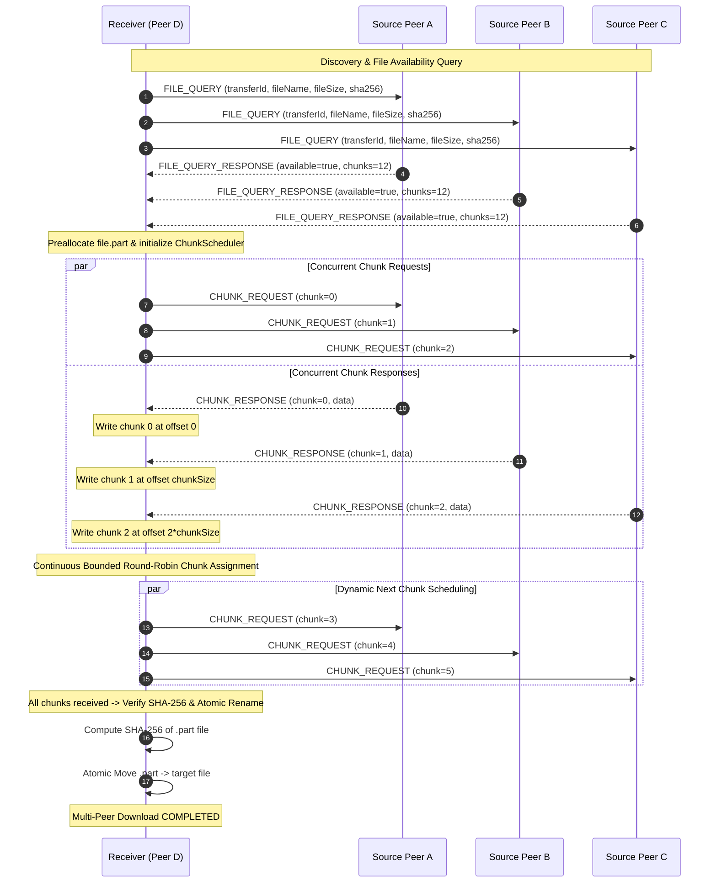

# LANDrop — Phase 9: Multi-Peer Concurrent File Transfer

## 1. Executive Summary

Phase 9 upgrades the LANDrop P2P file transfer engine from single-peer sequential downloading to **Multi-Peer Concurrent Downloading (Swarming)**. A receiving peer concurrently downloads distinct chunks of the same file from multiple available source peers over direct TCP sockets.

```text
Peer A ── chunks 0,3,6,9 ─────┐
Peer B ── chunks 1,4,7,10 ────┼──> Receiver (Assembles directly into single file)
Peer C ── chunks 2,5,8,11 ────┘
```

The system preserves strict decentralization:
- The **Discovery Server** is strictly for peer registration and IP/Port lookup; it **never relays file data**.
- All data transfers travel directly across independent TCP peer connections.
- Concurrent writes occur safely into a single `.landrop.part` file using positional `FileChannel` I/O.
- Transfer integrity is guaranteed by streaming SHA-256 calculation and atomic file promotion.

---

## 2. Multi-Peer Architecture & Sequence Flow



---

## 3. Protocol Extensions

Phase 9 introduces two backward-compatible message types into the LANDrop binary protocol without modifying existing message codes:

| Message Type | Opcode | Format | Description |
| :--- | :---: | :---: | :--- |
| `FILE_QUERY` | `20` | JSON | Broadcast/unicast query sent to known peers to check file availability |
| `FILE_QUERY_RESPONSE` | `21` | JSON | Peer response reporting whether it holds the file and can serve chunks |

Existing chunk transfer messages (`CHUNK_REQUEST (7)` and binary `CHUNK_RESPONSE (8)`) are reused directly.

### 3.1 `FILE_QUERY` (Type 20) Payload
```json
{
  "queryId": "7c9e6679-7425-40de-944b-e07fc1f90ae7",
  "fileName": "ubuntu-24.04-desktop-amd64.iso",
  "fileSize": 6120341504,
  "fileSha256": "3a0b...9f",
  "requesterPeerId": "peer-d",
  "requesterPeerName": "Peer D"
}
```

### 3.2 `FILE_QUERY_RESPONSE` (Type 21) Payload
```json
{
  "queryId": "7c9e6679-7425-40de-944b-e07fc1f90ae7",
  "available": true,
  "fileName": "ubuntu-24.04-desktop-amd64.iso",
  "fileSize": 6120341504,
  "chunkSize": 1048576,
  "totalChunks": 5837,
  "fileSha256": "3a0b...9f",
  "sourcePeerId": "peer-a",
  "sourcePeerName": "Peer A",
  "reason": ""
}
```

---

## 4. Chunk Scheduling Engine

Chunk management is divided into two thread-safe components:

### 4.1 Chunk Lifecycle (`ChunkManager` & `ChunkState`)
Each chunk follows a deterministic state transition:
```text
 MISSING ──> REQUESTED ──> TRANSFERRING ──> COMPLETED
    ▲             │              │
    └─────────────┴──────────────┘
           (Timeout / Disconnect / Retry Exhaustion)
```

- **Duplicate Assignment Prevention**: `markRequested(chunkIndex, peerId)` verifies that the chunk is strictly in `MISSING` state before binding it to a peer.
- **Peer Tracking**: `assignedPeers` maps each in-flight chunk to its designated peer ID.
- **Orphan Chunk Recovery**: When a peer disconnects or encounters an unrecoverable failure, `releasePeerChunks(peerId)` reverts all its uncompleted chunks back to `MISSING`.

### 4.2 Bounded Round-Robin Scheduler (`ChunkScheduler`)
- **Active Limit per Peer**: Each peer is capped at `maxActiveChunksPerPeer = 2` concurrent in-flight chunks to prevent socket buffer bloat and queue head-of-line blocking.
- **Fair Allocation**: Distributes chunks in round-robin fashion across all currently connected and available peers.
- **Dynamic Join / Leave**: As new peers are discovered or connected mid-transfer, they immediately become eligible on the next scheduling cycle.

---

## 5. Storage Engine: Concurrent Positional Writes

Receiving peers avoid in-memory chunk caching and write incoming chunks directly to disk using Java NIO `FileChannel`:

1. **Preallocation**:
   ```java
   this.partialFileChannel = FileChannel.open(partialPath,
           StandardOpenOption.CREATE, StandardOpenOption.READ, StandardOpenOption.WRITE);
   if (download.getFileSize() > 0) {
       partialFileChannel.truncate(download.getFileSize());
   }
   ```
2. **Thread-Safe Positional Writes**:
   ```java
   long offset = FileChunk.calculateChunkOffset(chunkIndex, download.getChunkSize());
   ByteBuffer buf = ByteBuffer.wrap(resp.data(), 0, resp.chunkLength());
   long currentOffset = offset;
   while (buf.hasRemaining()) {
       int written = partialFileChannel.write(buf, currentOffset);
       if (written <= 0) break;
       currentOffset += written;
   }
   ```
   Java's `FileChannel.write(ByteBuffer src, long position)` guarantees thread safety across concurrent virtual threads without corrupting file offsets.

---

## 6. Verification, Failover & Error Handling

### 6.1 SHA-256 Integrity Verification
When all chunks reach `COMPLETED`:
1. The coordinator closes worker threads and flushes the `FileChannel`.
2. Computes the streaming SHA-256 hash of `.landrop.part`.
3. Verifies that file length and SHA-256 match expected values.
4. Atomically renames `.part` to the destination file:
   ```java
   Files.move(partialPath, destPath, StandardCopyOption.ATOMIC_MOVE, StandardCopyOption.REPLACE_EXISTING);
   ```
5. If verification fails (hash mismatch or size error), the partial file is **immediately deleted** to prevent corrupt files from lingering.

### 6.2 Failover & Peer Disconnections
- **Per-Chunk Retries**: Workers retry failed or timed-out chunk requests up to `MAX_CHUNK_RETRIES = 3` times.
- **Peer Severing**: If a peer's connection drops or throws an I/O exception, the worker severs the peer, decrements active counts, marks the peer offline, and releases all its chunks back to `MISSING`.
- **Surviving Swarm Continuation**: Remaining peers continue downloading without interruption.
- **Total Peer Loss**: If all peers disconnect before the file is complete, the download enters `FAILED` state and unblocks waiting callers.

---

## 7. JavaFX Desktop UI Integration

The frontend seamlessly displays multi-peer swarm metrics:

1. **Aggregated Header Cards**:
   - Total active transfers, total speed (MB/s), active peers in swarm, and completed count.
2. **Swarm Transfer Row**:
   - File name, aggregated progress bar, dynamic status badge (`Downloading`, `Verifying`, `Completed`, `Failed`).
   - Transfer metrics: `Transferred / Total Size`, `Speed (MB/s)`, `ETA`.
   - **Per-Peer Contribution Badges**: e.g., `Peer A: 6 chunks (192 KB)`, `Peer B: 4 chunks (128 KB)`.
3. **⚡ Multi-Peer Download Modal**:
   - Page header includes a dedicated button to initiate multi-peer downloads.
   - Prompts for File Name, File Size, and Expected SHA-256 Hash.
   - Automatically queries all online peers from `PeerRegistry` and spawns a swarm session.

---

## 8. Test Verification Matrix

All 153 tests across backend and frontend pass with 100% success:

| Test Class | Scenarios / Methods | Description | Status |
| :--- | :---: | :--- | :---: |
| `ChunkManagerTest` | 8 tests | State transitions, bitset synchronization, orphan release | ✅ PASS |
| `ChunkSchedulerTest` | 6 tests | Bounded round-robin, active chunk limits, assignment rotation | ✅ PASS |
| `FileQueryMessageTest` | 4 tests | Message validation, JSON encoding/decoding, error handling | ✅ PASS |
| `PeerDownloadStateTest` | 4 tests | Metric tracking, thread-safe chunk counters, activity recording | ✅ PASS |
| `MultiPeerDownloadTest` | 4 tests | Coordinator initialization, status labels, speed & ETA calculations | ✅ PASS |
| `MultiPeerDownloadIntegrationTest` | 7 scenarios | Full swarm transfer, failover, late join, hash mismatch, disconnects | ✅ PASS |
| **All Other Backend Tests** | 109 tests | Phases 1–8: Core TCP, Protocol, Chat, Discovery, Resume & Retries | ✅ PASS |
| **Frontend UI Tests** | 11 tests | JavaFX FXML loader & UIStateService integration | ✅ PASS |
| **Total** | **153 tests** | Full test suite across root aggregator | **100% PASS** |
