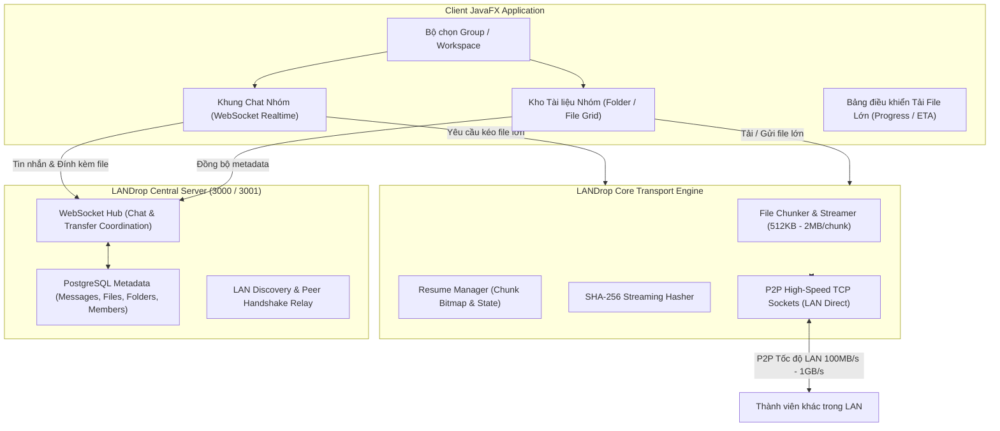

# Kế hoạch Thiết kế & Triển khai Client: Group Chat & Chia sẻ File Dung lượng Lớn

---

## 1. Mục tiêu & Định hướng Giải pháp

### 1.1 Vấn đề hiện tại của Client
- Các tính năng hiện tại bị phân mảnh trên thanh điều hướng bên trái: **Workspaces**, **Peers**, **Chat**, và **Transfers** nằm ở các màn hình tách biệt, làm gián đoạn trải nghiệm người dùng khi muốn vừa trao đổi công việc vừa gửi/nhận tài liệu.
- Việc truyền file hiện tại chủ yếu theo mô hình chọn người nhận thủ công trong danh sách Peer hoặc tạo yêu cầu transfer riêng lẻ, chưa gắn kết tự nhiên vào ngữ cảnh của một **Nhóm làm việc (Group/Workspace)**.
- Khi chia sẻ file dung lượng lớn (từ hàng trăm MB đến hàng chục GB như video raw, file nén dự án, ISO/bộ cài), người dùng cần:
  1. Gửi file trực tiếp ngay trong luồng chat nhóm hoặc kho tài liệu nhóm.
  2. Băng thông truyền tải đạt tối đa tốc độ mạng LAN (không bị giới hạn dung lượng bởi HTTP POST thông thường).
  3. Cơ chế cắt mảnh (chunking), truyền song song, xác thực mã băm SHA-256 và tự động phục hồi truyền tiếp (Resume) khi mất kết nối.
  4. Hiển thị thanh tiến trình trực quan (% hoàn thành, tốc độ MB/s, thời gian còn lại ETA).

### 1.2 Định hướng mới: "All-in-One Group Collaboration Hub"
Chuyển đổi Client LANDrop thành một không gian cộng tác nhóm thống nhất:
- **Trung tâm là Nhóm (Group/Workspace)**: Chọn nhóm &rarr; Ngay lập tức mở ra không gian gồm:
  - **Kênh Chat Nhóm (Group Chat)**: Trao đổi thời gian thực, đính kèm file lớn trực tiếp vào tin nhắn.
  - **Kho Tài liệu Nhóm (Group Documents & Drive)**: Phân mục cây thư mục, tìm kiếm, xem ai tải lên, dung lượng, lịch sử phiên bản.
  - **Danh sách thành viên trực tuyến (Active Group Members & Devices)**.
  - **Trung tâm truyền tải (Transfer Manager)**: Quản lý hàng đợi tải lên / tải về các file lớn.

---

## 2. Kiến trúc Kỹ thuật (Technical Architecture)



### 2.1 Cơ chế Chat Nhóm Realtime
- **Giao thức**: WebSocket (`ws://host:3001/api/realtime`) với chứng thực JWT token của phiên làm việc.
- **Tính năng tin nhắn**:
  - Gửi/nhận tức thì (độ trễ < 50ms trong LAN).
  - Phản hồi (Reply thread), xóa/sửa tin nhắn có cập nhật realtime cho toàn bộ thành viên trong Group.
  - Hiển thị danh sách tin nhắn cũ với phân trang vô tận (infinite scroll / load older).
  - Trạng thái người gửi: Avatar, Tên hiển thị (Display Name), Thiết bị gửi (Laptop/PC), Thời gian gửi.

### 2.2 Cơ chế Truyền File Kích Thước Lớn (Large File Transfer Protocol)
Để xử lý file từ **100 MB đến 50+ GB** mà không tràn bộ nhớ RAM hay gây nghẽn server:
1. **Zero-RAM Footprint (Streaming via `FileChannel` / `RandomAccessFile`)**:
   - File được đọc/ghi trực tiếp từ ổ đĩa theo luồng các khối nhỏ (Block size 1MB hoặc 2MB).
   - Không nạp toàn bộ file vào bộ nhớ RAM.
2. **P2P Direct TCP Transfer (Băng thông tối đa)**:
   - Metadata của file (Tên, dung lượng, MIME type, root SHA-256 hash, danh sách hash của từng chunk) được đăng ký lên máy chủ LANDrop và phát thông báo vào nhóm qua WebSocket.
   - Khi một thành viên trong nhóm bấm **"Tải về" (Download)**:
     - Máy chủ gửi lệnh bắt tay (Handshake) giữa máy người gửi và máy người nhận.
     - Hai máy kết nối trực tiếp qua TCP Socket P2P nội bộ LAN. Tốc độ truyền đạt tối đa phần cứng (100 MB/s trên mạng Gigabit, không tốn tài nguyên máy chủ).
3. **Khả năng tiếp tục truyền khi đứt mạng (Resumable Transfer)**:
   - Sử dụng **Chunk Bitmap (BitSet)** đánh dấu những chunk đã nhận thành công.
   - Khi mạng bị chập chờn hoặc máy tắt mở lại, client chỉ cần gửi lại danh sách các chunk còn thiếu (Missing Chunks), tiếp tục tải từ điểm dừng mà không cần gửi lại từ byte đầu tiên.
4. **Kiểm tra tính toàn vẹn (Integrity Guard)**:
   - SHA-256 từng chunk trong lúc nhận + đối soát mã băm tổng thể sau khi hoàn thành toàn bộ file.

---

## 3. Thiết kế Giao diện Client Mới (Client UI/UX)

### 3.1 Bố cục Tổng thể: 3 Cột Hiện Đại (Modern 3-Column Layout)

```
┌──────────────────────────────────────────────────────────────────────────────────────────────────┐
│ [LOGO] LANDrop  🟢 Server: 127.0.0.1:3000   🏢 [Group: Core Team ▾]       [User: The Anh] [⚙]   │
├───────────────┬─────────────────────────────────────────────────┬────────────────────────────────┤
│ CỘT 1: NHÓM   │ CỘT 2: KHÔNG GIAN CỘNG TÁC NHÓM                 │ CỘT 3: TIỆN ÍCH NHÓM           │
│ & KÊNH        │                                                 │                                │
│               │  [💬 Trò chuyện]    [📁 Kho Tài Liệu & Tệp]     │ 👥 THÀNH VIÊN TRỰC TUYẾN       │
│ 🏢 Core Team  │ ─────────────────────────────────────────────── │  ● The Anh (Bạn - Laptop)      │
│   # chung     │  The Anh • 14:02                                │  ● Alex (Office PC)            │
│   # tài-liệu  │  "Mọi người xem qua video demo bản mới nhé!"    │  ○ Sarah (Offline)             │
│   # kỹ-thuật  │                                                 │                                │
│               │  ┌───────────────────────────────────────────┐  │ ────────────────────────────── │
│ 🏢 Mobile App │  │ 🎬 Demo_Gameplay_4K_60fps.mp4             │  │ ⚡ TIẾN TRÌNH TRUYỀN TẢI       │
│   # general   │  │ Dung lượng: 4.8 GB • SHA-256: 8eae3...    │  │                                │
│               │  │ [⬇ Tải về P2P]   [📁 Mở thư mục chứa]    │  │ ⬇ Đang tải: Demo_Gameplay...   │
│ ───────────── │  │ ████████████████░░░░░░ 72% (78 MB/s)      │  │ [████████████░░] 72%           │
│ + Tạo Nhóm Mới│  └───────────────────────────────────────────┘  │ Tốc độ: 78.4 MB/s • Còn 18s   │
│               │                                                 │ [⏸ Tạm dừng] [✕ Huỷ]          │
│               │ ─────────────────────────────────────────────── │                                │
│               │ [📎 Đính kèm File Lớn] [Nhập tin nhắn...     ] [Gửi]                             │
└───────────────┴─────────────────────────────────────────────────┴────────────────────────────────┘
```

### 3.2 Chi tiết 2 Tab Chức Năng Chính trong Group

#### Tab 1: 💬 Trò chuyện Nhóm (Group Chat)
- **Danh sách tin nhắn thông minh**:
  - Tin nhắn văn bản thông thường, trích dẫn trả lời (Quote reply).
  - **Thẻ File Lớn (Large File Attachment Card)**:
    - Icon phân loại file trực quan: 🎬 Video, 📦 File nén, 📄 PDF/Document, 🖼 Hình ảnh, 💾 Bộ cài.
    - Hiển thị kích thước định dạng dễ đọc: `45.2 MB`, `3.6 GB`, `24.1 GB`.
    - Nút hành động trực tiếp: **"Tải về máy"**, **"Sao chép liên kết P2P"**, **"Xem chi tiết"**.
    - Tiến trình tải tích hợp ngay trên card khi người dùng bắt đầu tải.
- **Thanh nhập tin nhắn (Smart Input Bar)**:
  - Nút **`📎 Đính kèm Tệp`**: Hỗ trợ chọn 1 hoặc nhiều file bất kỳ dung lượng nào.
  - Hỗ trợ **Kéo - Thả (Drag & Drop)** file trực tiếp từ File Explorer của Windows vào khung chat.
  - Tự động hiển thị hộp thoại xem trước (Preview Dialog) gồm tên file, dung lượng, và cảnh báo dung lượng nếu là file siêu lớn (> 1 GB) để xác nhận trước khi truyền.

#### Tab 2: 📁 Kho Tài Liệu & Tệp Nhóm (Group Documents Vault)
- Dành cho các thành viên muốn tìm kiếm hoặc duyệt toàn bộ tài liệu đã chia sẻ trong nhóm mà không cần cuộn tìm lại tin nhắn chat:
  - **Cây thư mục**: Tạo thư mục lồng nhau (`/Tài liệu kỹ thuật`, `/Video demo`, `/Bộ cài đặt`).
  - **Chế độ hiển thị linh hoạt**: Dạng danh sách bảng (Table View) hoặc dạng lưới thẻ (Grid View).
  - **Thông tin chi tiết**: Tên file, kích thước, người tải lên, thời gian cập nhật, mã băm SHA-256.
  - **Tìm kiếm & Lọc nhanh**: Tìm kiếm theo tên file, lọc theo định dạng (PDF, Media, Archives).

#### Khay Quản Lý Tiến Trình (Transfer Drawer / Floating HUD)
- Nằm ở góc phải hoặc drawer trượt ra:
  - Danh sách toàn bộ các tác vụ tải lên (Upload) và tải về (Download).
  - Hiển thị biểu đồ đo tốc độ thời gian thực (Speed Gauge: ví dụ `85.4 MB/s`).
  - Các nút điều khiển: **Tạm dừng (Pause)**, **Tiếp tục (Resume)**, **Hủy (Cancel)**, **Mở thư mục chứa (Open Folder)** sau khi tải xong.

---

## 4. Kế hoạch Triển khai Chi tiết (Phased Roadmap)

| Giai đoạn | Nội dung công việc | Kết quả đầu ra (Deliverables) |
| :--- | :--- | :--- |
| **Giai đoạn 1**<br>*(Tái cấu trúc Layout & Group Chat)* | - Tái thiết kế bố cục chính Client sang mô hình Group-Centric 3 cột (`main-view.fxml`, `ChatController`, `WorkspaceController`).<br>- Hợp nhất Workspace và Chat thành một trải nghiệm liền mạch.<br>- Hiển thị danh sách thành viên trực tuyến theo Group. | Giao diện nhóm hiện đại, chat realtime ổn định, hiển thị thành viên online theo từng nhóm. |
| **Giai đoạn 2**<br>*(Đính kèm & Truyền File Lớn trong Chat)* | - Xây dựng component giao diện `FileAttachmentCard` (tên, size, icon, nút download, progress bar).<br>- Tích hợp kéo thả Drag & Drop file vào khung chat.<br>- Gắn kết sự kiện upload metadata lên Server và phát realtime qua WebSocket. | Thành viên có thể kéo thả gửi file lớn trực tiếp trong khung chat nhóm. |
| **Giai đoạn 3**<br>*(Nâng cấp Engine Truyền File Lớn P2P)* | - Tối ưu `FileTransferService` và `TcpTransferEngine`: Streaming I/O theo chunk 1-2MB, không tải vào RAM.<br>- Hoàn thiện giao thức Resume (đánh dấu chunk bitmap, tái kết nối khi đứt mạng).<br>- Tính toán SHA-256 streaming và hiển thị tốc độ MB/s, ETA. | File lớn (1GB - 50GB+) truyền P2P giữa các máy trong mạng LAN với tốc độ tối đa, hỗ trợ Pause/Resume. |
| **Giai đoạn 4**<br>*(Kho Tài Liệu Nhóm & Quản Lý File)* | - Tích hợp giao diện quản lý file (`FileManagerStateService`) thành Tab "Kho Tài Liệu" ngay trong Group.<br>- Tạo thư mục, di chuyển, phân loại, tìm kiếm tài liệu trong Group.<br>- Tải về bất kỳ file nào từ kho tài liệu theo luồng P2P. | Kho lưu trữ tài liệu nhóm trực quan, dễ quản lý và tra cứu. |
| **Giai đoạn 5**<br>*(Khay Tiến Trình Transfer & Kiểm Thử)* | - Xây dựng bảng điều khiển Transfer Hub (theo dõi tiến độ đa luồng, pause/resume/cancel).<br>- Viết bổ sung Unit & Integration Tests cho luồng Group Chat và Truyền file lớn.<br>- Kiểm thử thực tế tốc độ truyền file lớn trên môi trường mạng nội bộ. | Hệ thống hoàn thiện, kiểm thử tự động pass 100%, sẵn sàng bàn giao. |
