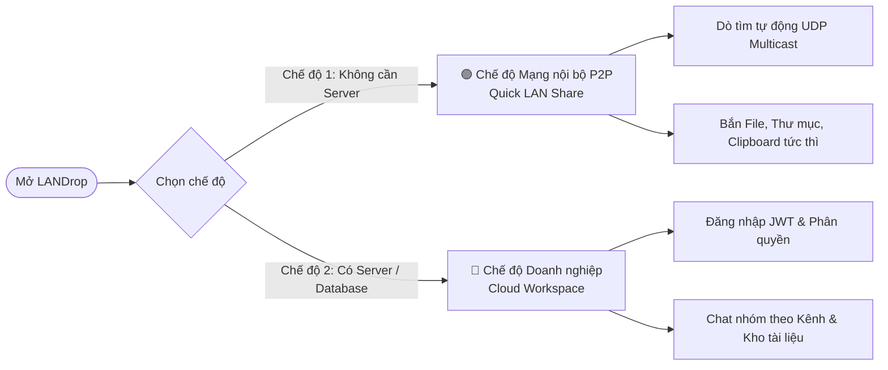

# Sổ Tay Hướng Dẫn Sử Dụng LANDrop Desktop (User Guide)

Chào mừng bạn đến với **LANDrop** – giải pháp truyền file mạng nội bộ P2P và cộng tác nhóm tốc độ cao, an toàn và dễ sử dụng!

---

## 1. Giới thiệu & Hai Chế độ Hoạt động (Dual-Mode)

LANDrop cung cấp **mô hình hoạt động kép (Hybrid Dual-Mode)** độc đáo:



1. **Chế độ Mạng nội bộ P2P (Offline / Standalone Mode):**
   - Không cần kết nối Internet, không cần máy chủ trung tâm, không cần tạo tài khoản.
   - Tương tự như Apple AirDrop hoặc LocalSend: chỉ cần mở ứng dụng là các máy tính trong cùng mạng WiFi / LAN tự động thấy nhau và có thể bắn file, gửi thư mục, chia sẻ clipboard ngay lập tức.
2. **Chế độ Không gian Làm việc (Cloud Workspace Mode):**
   - Đăng nhập tài khoản, lưu trữ lịch sử tin nhắn, quản lý nhiều không gian làm việc (Workspaces), phân quyền thành viên (Owner, Admin, Member), và quản lý kho tài liệu chung (Documents Vault).

---

## 2. Bắt đầu Nhanh (Quick Start)

### 2.1 Mở ứng dụng ở Chế độ Mạng nội bộ P2P (Khuyên dùng)
- **Trên Windows:** Nhấp đúp chuột vào file [`start-peer-standalone.bat`](file:///C:/TheAnhproject/LANDrop/start-peer-standalone.bat) hoặc mở file `LANDrop.exe`.
- **Trên macOS / Linux:** Chạy lệnh `./start-peer-standalone.sh`.
- Tại màn hình đăng nhập, nhấp vào nút:
  > **⚡ Dùng chế độ mạng nội bộ P2P (Không cần tài khoản)**
- Ứng dụng sẽ mở giao diện chính ngay lập tức.

### 2.2 Tự động Dò tìm Thiết bị (Zero-Config UDP Multicast)
- Bạn không cần gõ IP của máy khác! Ứng dụng sử dụng kênh multicast `239.255.88.88:8889` để tự động phát hiện mọi thiết bị đang bật LANDrop trong cùng mạng nội bộ.
- Chuyển sang mục **"👥 Peers"** để xem danh sách các máy tính đang trực tuyến.

---

## 3. Các Tính Năng Chính

### 3.1 Truyền File Lớn Siêu Tốc
- **Chia khối 1MB:** File được tự động cắt thành các khối 1MB và truyền qua socket TCP tốc độ cao (đạt băng thông tối đa của mạng LAN WiFi/Ethernet, thường từ 50MB/s đến 110MB/s).
- **Tiếp tục khi gián đoạn (Resume):** Nếu bạn vô tình ngắt kết nối WiFi, ứng dụng lưu lại bitmap các khối đã tải và tự động tiếp tục truyền ngay khi kết nối lại, không phải tải lại từ đầu.
- **Kiểm tra Toàn vẹn SHA-256:** Mỗi tệp truyền tải đều được đối soát mã băm SHA-256 để đảm bảo tệp nhận được hoàn toàn nguyên vẹn, không bị hỏng hóc.

### 3.2 Gửi Nguyên Cây Thư Mục (Folder Transfer)
- Chọn tệp hoặc thư mục bất kỳ. LANDrop tự động quét đệ quy các thư mục con và đóng gói theo cấu trúc phân cấp, sau đó giải nén an toàn ở máy nhận.

### 3.3 Đồng bộ Clipboard LAN Siêu Tốc (Shared Clipboard)
- Trên máy A: Nhấn `Ctrl + C` để copy bất kỳ đoạn văn bản, đường link URL hoặc mã OTP.
- Vào mục **"👥 Peers"**, nhấp vào nút **"📋 Gửi Clipboard"** trên thẻ của máy B.
- Máy B sẽ nhận được thông báo khay hệ thống và nội dung được tự động sao chép vào Clipboard của máy B! Bạn chỉ cần nhấn `Ctrl + V` để dán.

### 3.4 Bảo mật & Mã hóa Đầu cuối (E2EE AES-256-GCM)
- Mỗi phiên kết nối P2P tự động thỏa thuận khóa bảo mật thông qua giao thức **ECDH (NIST P-256)**.
- Dữ liệu tệp và tin nhắn được mã hóa bằng **AES-256-GCM** với mã xác thực 128-bit chống nghe lén và chống sửa đổi dữ liệu trên mạng WiFi công cộng.

### 3.5 Giao diện Tối / Sáng (Dark Mode)
- Nhấp vào biểu tượng **`🌙` / `☀️`** ở góc trên cùng bên phải để chuyển đổi tức thì giữa giao diện Sáng (Light) và giao diện Tối kỹ thuật (Dark Slate).

### 3.6 Chạy Ngầm Khay Hệ thống (System Tray)
- Khi bấm nút `✕` ở góc cửa sổ, LANDrop không tắt hẳn mà thu gọn xuống khay đồng hồ Windows.
- Ứng dụng vẫn chạy ngầm để sẵn sàng nhận file bất kỳ lúc nào.
- Nhấp chuột phải vào biểu tượng LANDrop ở khay hệ thống để:
  - *Mở LANDrop*
  - *Bật/Tắt tự động nhận file*
  - *Mở thư mục Tải về*
  - *Thoát hoàn toàn*

---

## 4. Triển khai Máy chủ Doanh nghiệp qua Docker

Nếu công ty hoặc đội nhóm của bạn muốn sử dụng chế độ Workspace đầy đủ (lưu trữ cơ sở dữ liệu trên PostgreSQL):

1. Mở cửa sổ dòng lệnh tại thư mục dự án.
2. Khởi chạy toàn bộ hệ thống bằng Docker Compose:
   ```bash
   docker compose up -d
   ```
3. Truy cập các cổng dịch vụ:
   - **Giao diện Quản trị Server (Admin Dashboard):** [http://localhost:3000/admin](http://localhost:3000/admin)
   - **REST API & Kiểm tra trạng thái:** [http://localhost:3000/health](http://localhost:3000/health)
   - **WebSocket Realtime Gateway:** `ws://localhost:3001`
   - **Cơ sở dữ liệu PostgreSQL:** `localhost:5432`

---

## 5. Đóng Gói Ứng Dụng Thành File `.exe` Cho Windows

Để tạo bộ cài đặt hoặc file chạy độc lập cho người dùng không cài đặt Java:

1. Chạy script:
   ```cmd
   .\package-windows.bat
   ```
2. Quá trình đóng gói sẽ tự động:
   - Biên dịch mã nguồn cả hai phân hệ `backend` và `frontend`.
   - Thu thập toàn bộ thư viện phụ thuộc vào `target/libs`.
   - Sử dụng công cụ `jpackage` của JDK 21 để đóng gói kèm JRE rút gọn.
3. Ứng dụng độc lập sau khi đóng gói sẽ nằm tại:
   ```
   dist\LANDrop\LANDrop.exe
   ```
   Chỉ cần copy thư mục này sang bất kỳ máy tính Windows nào là có thể mở và dùng ngay!

---

## 6. Khắc Phục Sự Cố Thường Gặp (Troubleshooting)

| Vấn đề | Nguyên nhân | Cách xử lý |
| :--- | :--- | :--- |
| **Không thấy máy khác trong mạng** | Tường lửa Windows Firewall chặn gói tin UDP/TCP. | Mở Windows Firewall, cho phép ứng dụng `LANDrop` truy cập mạng `Private Network`. Hoặc kiểm tra xem 2 máy có cùng kết nối vào một mạng WiFi/Router hay không (tránh mạng Guest bị cô lập client isolation). |
| **Cổng kết nối bị trùng (Port occupied)** | Có ứng dụng khác đang chiếm cổng 5001. | LANDrop có cơ chế tự động thử cổng kế tiếp (5002, 5003...) khi phát hiện cổng bị trùng. |
| **Tốc độ truyền chậm trên WiFi** | Băng thông WiFi 2.4GHz bị nghẽn. | Khuyên dùng băng tần WiFi 5GHz / WiFi 6 hoặc cắm dây mạng LAN để đạt tốc độ truyền tải tối đa (> 80 MB/s). |
