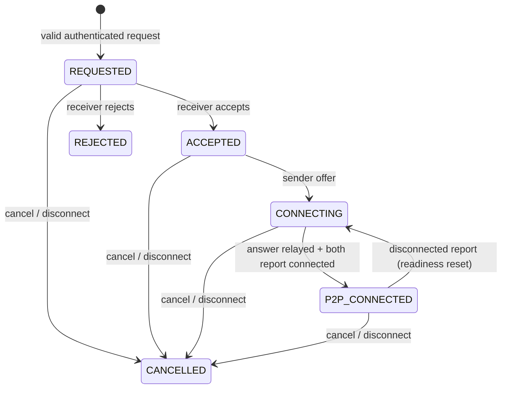

# REALTIME-02 shared browser signaling contract

Status: **AGREED**. Scope: REALTIME-02A backend signaling and temporary session coordination.
Date: 2026-10-09. The user accepted the proposed Client contract before implementation in this session.

This extends [REALTIME-01](REALTIME_01_CONTRACT.md) on `FoundationRealtimeServer`.
Use the same socket, protocolVersion 1, `hello`, `auth`, `auth_ack`, heartbeat,
Origin allowlist and authenticated session binding. No second gateway or protocol.
The older native `RealtimeServer`/persistent file APIs are separate existing systems;
their `transfer:*` events and database transfer IDs are not browser signaling sessions.

## Envelope and correlation

```json
{"type":"webrtc.offer","requestId":"offer-1","payload":{"transferId":"<server-issued UUID>","sdp":{"type":"offer","sdp":"<opaque SDP>"}}}
```

Server adds `timestamp`. Command responses retain `requestId`; peer relays also retain
it. Every transfer notification/relay/ack contains `payload.transferId`. Unsolicited
status/cleanup events omit requestId. Use unique command requestIds and map them to
the transfer locally. Errors use the existing `error` event with
`error: {code,message}` and the command requestId. No request deduplication or retry
of successful offer/answer is provided; a delivery ack means queued on the peer's
WebSocket, not confirmation that the peer applied the signal.

## Commands and responses

| Client event | Required payload | Result |
| --- | --- | --- |
| `transfer.request` | `workspaceId`, `receiverConnectionId`, `fileName`, integral `fileSize` | Server allocates ID, sends `transfer.request` to that exact receiver and `transfer.status` REQUESTED to sender. Existing `targetConnectionId` alias is retained. |
| `transfer.accept` | `transferId` | Bound receiver only, REQUESTED only. Receiver gets `transfer.status` ACCEPTED; sender gets `transfer.accept`. |
| `transfer.reject` | `transferId`, optional `reason` | Bound receiver only, REQUESTED only. Receiver gets REJECTED status; sender gets `transfer.reject`. |
| `transfer.cancel` | `transferId`, optional `reason` | Either bound participant, active state only. Actor gets CANCELLED status; peer gets `transfer.cancel`. |
| `webrtc.offer` | `transferId`, `sdp: {type:"offer",sdp:string}` | Bound sender only, ACCEPTED only, once. Peer gets identical SDP; optional `webrtc.offer_ack`; both get CONNECTING status. |
| `webrtc.answer` | `transferId`, `sdp: {type:"answer",sdp:string}` | Bound receiver only after offer, once. Peer gets identical SDP; optional `webrtc.answer_ack`. |
| `webrtc.ice_candidate` | `transferId`, `candidate: RTCIceCandidateInit` or null | Either participant after Accept, relay to bound peer; optional `webrtc.ice_candidate_ack`. Existing name retained. |
| `webrtc.candidate` | Same candidate payload | Agreed alias. Relay/ack retain this name: `webrtc.candidate`, `webrtc.candidate_ack`. |
| `webrtc.connection-status` | `transferId`, `status` | Either participant; relay and optional `webrtc.connection-status_ack`. Allowed values below. |

File metadata is descriptive only. No file must be registered in File Manager.
Filename is reduced to a basename; empty/control-character/traversal names are
rejected. Size is 0..5 TiB, preserving the existing coordinator limit. Existing
`sha256` metadata is ignored; the server neither computes nor validates a file hash.

`sdp` is opaque: the server validates only the description shape/type and 48 KiB
string limit, then forwards the original object without changing SDP text. Candidate
strings are limited to 8 KiB. The gateway's existing 64 KiB frame limit also applies.
Candidate is an object with textual `candidate`, optional nullable textual `sdpMid`,
optional nullable nonnegative integer `sdpMLineIndex`, and browser fields such as
`usernameFragment`; null means end-of-candidates. There are no browser IP/port defaults.

The old generic `webrtc.signal` is no longer a routing shortcut; it returns
INVALID_PAYLOAD for a valid participant. Send the typed events above.

## Server payloads

Transfer notifications/status share this projection (session IDs stay server-side):

```json
{
  "transferId":"...", "workspaceId":"...",
  "senderUserId":"...", "senderConnectionId":"...",
  "receiverUserId":"...", "receiverConnectionId":"...",
  "fileName":"sample.txt", "fileSize":42,
  "status":"REQUESTED", "createdAt":"<ISO-8601>", "expiresAt":"<ISO-8601>",
  "reason":"<optional terminal reason>"
}
```

SDP/ICE/status relays include `transferId`, `workspaceId`, server-derived
`fromConnectionId`, `fromUserId` and the original `sdp`, `candidate` or `status`.
Unknown outer payload fields (including forged identities) are not forwarded.
Clients never choose the route for an existing transfer. Optional legacy
`toConnectionId` must match the bound counterpart or the command is FORBIDDEN.

Signaling acks include `{transferId,status:"delivered",toConnectionId}`.
`transfer.status` carries the coordinated lifecycle state; `webrtc.connection-status`
carries a participant's reported browser connection state. They are distinct values.

## Lifecycle



Any active state may become EXPIRED at the fixed deadline, FAILED on revoked
workspace access or delivery failure. After Accept, reported `failed` or `closed`
also causes FAILED. `connecting` is accepted after the offer; `connected` requires
the relayed answer. Both peers must report connected for P2P_CONNECTED. A
`disconnected` report after an offer returns to CONNECTING and resets both readiness
flags; peers must both report connected again before the fixed deadline. No ICE
restart/SDP renegotiation is implemented in this milestone.

ICE may be relayed immediately after Accept, including before offer/answer reaches
the browser. **Client must buffer ICE per transferId until setRemoteDescription
succeeds**, then drain in order (including null). No server-side candidate buffer.

The existing COMPLETED enum value remains reserved for compatibility; this signaling
API does not transition to it and never declares a file transfer completed.

## Authorization and routing

Every command requires a currently registered/open authenticated connection,
unexpired access token, active persistent session, matching session-device binding
and enabled user, through the REALTIME-01 verifier. Receiver checks run before
request delivery and every relay, including when the receiver sends no messages.

Both identities must have current OWNER, ADMIN or MEMBER membership in the same
existing workspace, through `WorkspaceAccess.requireMember`; GUEST and missing
membership are denied. Workspace database errors fail closed. Permissions are
rechecked on each command and by the periodic sweep.

The coordinator records server-derived userId/sessionId/connectionId for both
participants. Another tab/session of the same user cannot use that transfer.
Payload `userId`, sender/receiver identity and role cannot establish authority.
Origin checks, query-token rejection and session revocation remain in the shared
gateway. Missing auth dependencies also fail closed for signaling.

## Timeout, cleanup and errors

Default lifetime is **120000 ms from creation**, configurable with
`WEBRTC_SESSION_TTL_MS` / `-Dlandrop.webrtc.session.ttl.ms`. It is not extended by
Accept, ICE or a connected report. Expiry ends the signaling window, including for
P2P_CONNECTED; it does not assert anything about the browser's data-plane progress.
The gateway's existing periodic sweep expires sessions and notifies still-authorized
participants with `transfer.status` EXPIRED and `reason: SIGNALING_TIMEOUT`.
Commands at/after expiresAt are rejected immediately even before the next sweep.

Reject/cancel/failure/disconnect end active coordination immediately and clear
negotiation readiness flags. Metadata tombstones (no SDP/ICE) are retained for
60 seconds, then removed. Limits: 16 active sessions per connection, 4096 total
records including tombstones; overflow returns TRANSFER_LIMIT_REACHED.

Either socket disconnect, heartbeat timeout, replaced connection or logout/revoke
cancels its active sessions. The authorized online counterpart receives
`transfer.cancel`, CANCELLED, `reason: PEER_DISCONNECTED`. Invalid runtime sessions
are closed through REALTIME-01 and removed; no signal can go to a revoked receiver.
Membership removal causes FAILED/WORKSPACE_ACCESS_REVOKED; the removed user receives
no further transfer notifications. A race where delivery fails causes
FAILED/PEER_UNAVAILABLE and RECEIVER_NOT_FOUND. Cleanup is idempotent.

All records are temporary in-memory coordination; no database table is added.
Shutdown clears all records. After server restart or reconnect, create a new
request, wait for a fresh Accept, and use the new transferId. Never replay old SDP/ICE.

| Error code | Meaning |
| --- | --- |
| `AUTH_REQUIRED`, existing REALTIME-01 auth codes | Authenticate/reconnect; session/token invalidation may close the socket. |
| `INVALID_PAYLOAD` | Invalid workspace/metadata/description/candidate/event shape. |
| `FORBIDDEN` | Not the bound participant/receiver, redirected destination or workspace access denied. |
| `RECEIVER_NOT_FOUND` | Target offline, unauthenticated, revoked or undeliverable. |
| `TRANSFER_NOT_FOUND` | Unknown ID, purged record or ID from a previous server lifetime. |
| `TRANSFER_EXPIRED` | Bound signaling session exceeded its fixed deadline. |
| `INVALID_TRANSFER_STATE` | Before consent, wrong offer/answer role/order, duplicate description or terminal session. |
| `TRANSFER_LIMIT_REACHED` | Session capacity reached. |
| `INTERNAL_ERROR` | Unexpected signaling authorization failure; no SDP/ICE detail is exposed. |

## Frontend integration

1. Authenticate the existing `RealtimeClient`; retain the server's welcome connectionId.
2. Resolve/select the exact online receiver connection through existing peer presence.
   The backend intentionally does not add a new workspace presence/listing feature.
3. Send transfer.request; correlate sender status and receiver notification by transferId.
4. Receiver sends Accept/Reject. Only after ACCEPTED, sender creates/sends an offer;
   receiver applies it and sends an answer. Use `RTCSessionDescriptionInit` objects.
5. Send `event.candidate?.toJSON() ?? null` in candidate events; buffer incoming
   candidates separately for each transfer until its remote description is ready.
6. Report `RTCPeerConnection.connectionState` with connection-status and consume
   transfer.status. P2P_CONNECTED requires both reports; it is not proof of delivery.
7. On terminal coordination/expired/revoke/disconnect, discard the signaling mapping
   and buffered candidates. On reconnect repeat hello/auth and start a fresh transfer.
8. Add generic envelope listeners/send methods to the existing RealtimeClient so chat
   room subscriptions and broadcasts continue on the same socket.

The frontend is responsible for RTCPeerConnection/ICE configuration. This backend
milestone contains no RTCDataChannel binary handling, chunking, hashing, save/download,
File Manager integration or REALTIME-03 behavior.
