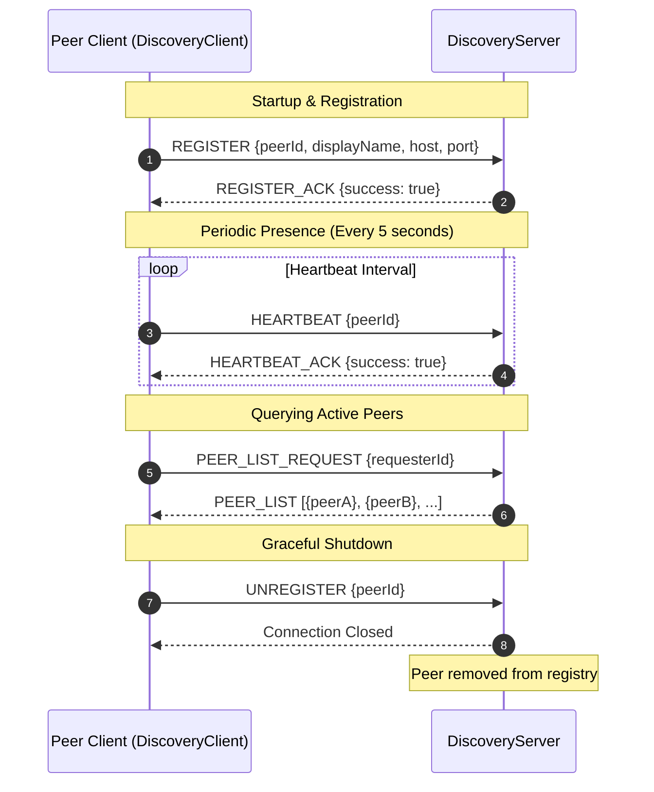
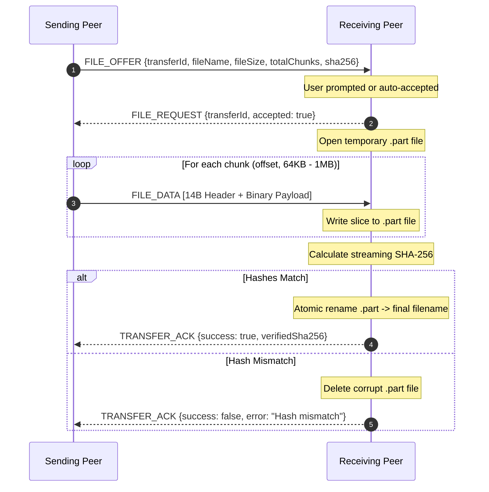
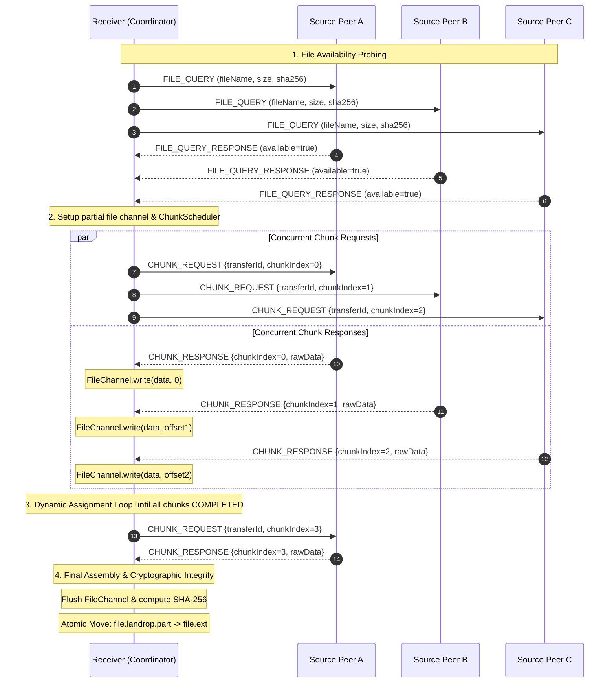
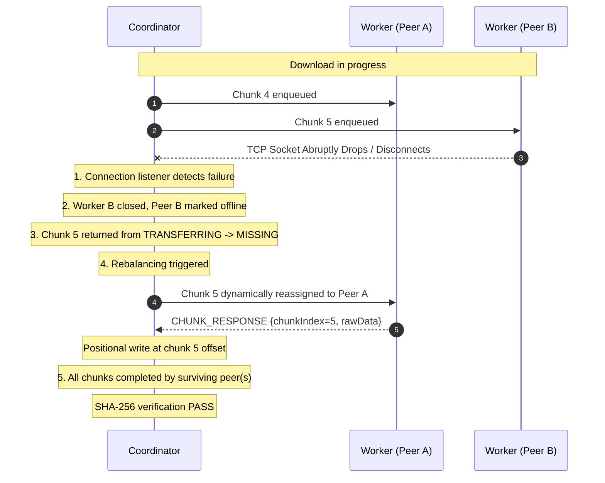

# LANDrop LAN Core Architecture

> Scope: Java TCP LAN engine. The current frontend is Next.js and has a separate browser transport. Shared HTTP/auth/workspace/admin services are documented in [the documentation index](../README.md).

This document describes the high-level system architecture, component relationships, concurrency model, and core interaction flows of **LANDrop**, a decentralized local-area network (LAN) peer-to-peer file sharing and messaging platform.

---

## 1. System Overview

LANDrop utilizes a **hybrid P2P topology**:
- A lightweight, centralized **Discovery Server** coordinates presence and dynamic peer registry.
- LAN core chat, single-peer file streaming, and multi-peer chunk swarming use **direct, point-to-point TCP connections** between Java peers. Workspace chat uses the separate authenticated HTTP/WebSocket services.

```text
               +---------------------------+
               |     Discovery Server      |
               |       (Port 8888)         |
               +-------------+-------------+
                             ^
     Presence Heartbeats     |     Peer Registry Queries
     (REGISTER, HEARTBEAT)   |     (PEER_LIST)
       +---------------------+---------------------+
       |                     |                     |
+------+------+       +------+------+       +------+------+
|   Peer A    |<=====>|   Peer B    |<=====>|   Peer C    |
| (Port 5001) |  TCP  | (Port 5002) |  TCP  | (Port 5003) |
+------+------+       +------+------+       +------+------+
       ^                     ^                     ^
       |                     |                     |
       +=====================+=====================+
                      Direct TCP Swarm
                             |
                      +------+------+
                      |   Peer D    |
                      |  (Receiver) |
                      | (Port 5004) |
                      +-------------+
```

### Discovery vs. Direct Peer-to-Peer Communication
- **Discovery Role**: Minimalistic directory coordinator. Peers register their IP, port, and display name, refresh via heartbeats every 5 seconds, and fetch active peer lists. **The Discovery Server never touches file data or chat payloads.**
- **P2P Communication Role**: Direct raw TCP sockets established between peers. High-volume transfers achieve full network interface bandwidth without central server bottlenecks.

---

## 2. Module Responsibilities

Maven manages the backend module. The frontend is a separate npm application:

```text
LANDrop
├── backend (Protocol, Discovery, Networking, Storage, Transfer Engine)
└── frontend (Next.js routes, React state, browser WebRTC transport)
```

### 2.1. Backend Module (`com.landrop.*`)
- **`com.landrop.protocol`**:
  - Encapsulates discrete packets with a 14-byte wire framing header.
  - Handles streaming serialization (`PacketEncoder`) and robust deserialization (`PacketDecoder`) with fragmentation guardrails.
  - Implements request-response correlation via `RequestIdGenerator`.
- **`com.landrop.discovery`**:
  - `DiscoveryServer`: Concurrent socket server managing the active peer registry, heartbeats, and peer pruning.
  - `DiscoveryClient`: Client agent handling auto-registration, background heartbeat scheduling, and peer querying.
- **`com.landrop.peer`**:
  - `PeerConnection`: Full-duplex TCP transport wrapper supporting asynchronous reader loops (Java 21 virtual threads) and synchronized thread-safe writes.
  - `PeerServer`: Server socket listener accepting inbound peer connections.
  - `ConnectionPurpose`: Multiplexing tag (`CHAT` vs `FILE_TRANSFER`) allowing dedicated connections for transfers.
- **`com.landrop.chat`**:
  - `ChatService`: In-memory peer chat session manager.
  - `ChatHistory`: Real-time chronological message store with status callbacks.
- **`com.landrop.transfer`**:
  - `FileTransferService`: High-level engine orchestrating single-peer transfers and multi-peer downloads.
  - `SharedFileScanner`: Scans and indexes local shared directories to answer peer availability queries.
  - `MultiPeerDownloadCoordinator`: Coordinates multi-source file swarms, worker lifecycles, and cryptographic verification.
  - `ChunkScheduler`: Deterministic round-robin scheduler assigning missing chunks across active peers.
  - `ChunkManager`: Thread-safe bitset/bitmap tracking state (`MISSING`, `REQUESTED`, `TRANSFERRING`, `COMPLETED`) for each file chunk.
  - `PeerDownloadWorker`: Worker thread requesting chunks from an individual peer and performing positional writes via Java NIO `FileChannel`.
- **`com.landrop.config`**:
  - `AppConfig`: Centralized configuration management with JVM property and environment variable overrides.
- **`com.landrop.util`**:
  - `AppLogger`: Zero-dependency structured logging framework with sensitive data sanitization.

### 2.2. Browser Frontend

The Next.js frontend is described in [frontend/README.md](../../frontend/README.md). Its WebRTC service is independent of Java TCP packets, and current UI flows still include mock data and simulated transfers. These LAN core diagrams do not establish a browser-to-Java transport bridge.

---

## 3. Discovery Lifecycle Flow



---

## 4. Single-Peer File Transfer Flow



---

## 5. Multi-Peer Concurrent Download (Swarming) Flow



---

## 6. Dynamic Peer Join & Mid-Transfer Failover

### 6.1. Dynamic Late Peer Join
When an additional source peer becomes available while a download is already in progress:
1. `MultiPeerDownloadCoordinator.addSourcePeer()` creates and starts a `PeerDownloadWorker` for the new peer.
2. The worker immediately queries `ChunkScheduler.scheduleNextAssignments()`.
3. Unassigned or pending chunks are partitioned across the newly expanded peer pool without pausing the download.

### 6.2. Failover & Chunk Reassignment Flow


