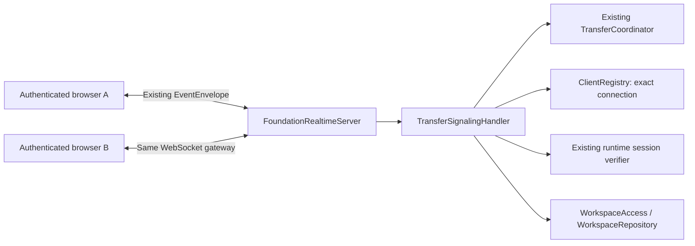

# REALTIME-02A backend acceptance report

Date: 2026-10-09. **REALTIME-02A COMPLETE** for backend signaling and session coordination.
Acceptance: JDK 21.0.12.1, Maven 3.9.16, `mvn clean install "-Dlandrop.database.enabled=false"`
completed with BUILD SUCCESS: **335 tests discovered, 300 passed, 35 skipped, 0 failures, 0 errors**.
The new signaling suite passed all 16 real-WebSocket tests. PostgreSQL-dependent
checks are explicitly excluded from this acceptance run; browser-to-browser actual
PeerConnection connectivity is a frontend/LAN integration check, not claimed here.

## 1. Files changed/created by this milestone

Production:

| File | Change |
| --- | --- |
| `backend/src/main/java/com/landrop/server/realtime/TransferSignalingHandler.java` | New separate authorized transfer/SDP/ICE/status handler on the existing gateway. |
| `backend/src/main/java/com/landrop/server/transfers/SignalingException.java` | New safe signaling error with existing envelope error codes. |
| `backend/src/main/java/com/landrop/server/realtime/FoundationRealtimeServer.java` | Delegate transfer/signaling events, reuse periodic sweep/disconnect/shutdown hooks, inject workspace repository. |
| `backend/src/main/java/com/landrop/server/transfers/TransferCoordinator.java` | Extend existing coordinator with bound participants, consent/negotiation states, expiry/retention/capacity and serialized transitions. |
| `backend/src/main/java/com/landrop/server/transfers/TransferRecord.java` | Workspace/user/session/connection metadata, expiresAt and negotiation/readiness flags; no SDP/ICE storage. |
| `backend/src/main/java/com/landrop/server/transfers/TransferStatus.java` | REQUESTED, CONNECTING, P2P_CONNECTED and EXPIRED. |
| `backend/src/main/java/com/landrop/server/protocol/ProtocolConstants.java` | Retain old ICE name, add candidate alias and connection-status event. |
| `backend/src/main/java/com/landrop/server/bootstrap/ServerBootstrap.java` | Wire existing WorkspaceRepository into signaling. |
| `.env.example` | Document WEBRTC_SESSION_TTL_MS. |

Tests/documentation:

| File | Change |
| --- | --- |
| `backend/src/test/java/com/landrop/server/SignalingTestSupport.java` | New controlled auth/session/workspace fixture using real verifier and access checks. |
| `backend/src/test/java/com/landrop/server/realtime/WebRTCSignalingRelayTest.java` | Replace unauthenticated smoke test with 16 real-socket security/lifecycle/routing/regression tests. |
| `backend/src/test/java/com/landrop/server/LandropServerFoundationTest.java` | Migrate transfer tests to authenticated workspace requests; retain other checks. This file also contained unrelated pre-existing edits. |
| `backend/src/test/java/com/landrop/server/LanIntegrationGateTest.java` | Migrate transfer tests to agreed contract and document ignored legacy hash metadata. |
| `backend/src/test/java/com/landrop/chat/PersistentChatTest.java` | Mount existing production routes directly with in-memory dependencies; prevent unrelated default database initialization. |
| `backend/src/test/java/com/landrop/file/FileManagementTest.java` | Same fixture correction; no production File Manager feature change. |
| `docs/api/REALTIME_02_SIGNALING_CONTRACT.md` | New agreed contract and frontend integration reference. |
| `docs/README.md` | Index the signaling contract. |
| `docs/reports/REALTIME_02A_BACKEND_REPORT.md` | This report. |

Other desktop/auth/HTTP/frontend/launcher working-tree changes were already present
or appeared from another ongoing workflow; they are not included in this milestone's
change inventory. They were preserved. No commit or publishing action was performed.

## 2. Audit and coordinator architecture

| Existing component | Audit finding and reuse |
| --- | --- |
| FoundationRealtimeServer | Reused listener, browser Origin policy, hello/auth, runtime validation, heartbeat, chat rooms, reconnection and close/shutdown. Old transfer methods/unsafe arbitrary-destination relay replaced by delegation. |
| TransferCoordinator/TransferRecord | Existing runtime in-memory metadata model was suitable; lacked workspace/identity binding, atomic lifecycle, expiry and bounded retention. Extended in place. |
| WebRTC relay | Already had offer/answer/ice_candidate and acks; accepted arbitrary toConnectionId without consent/participant authorization. That shortcut is closed. |
| SessionVerifier and gateway runtime session checks | Reused active session ownership/revoke/expiry, enabled user, access-token expiry and device binding. Target session is also verified before delivery. |
| ClientRegistry | Reused exact connection lookup, session/user indices, revocation, instance replacement and registry removal. No new online registry. |
| WorkspaceAccess/WorkspaceRepository | Reused existing centralized OWNER/ADMIN/MEMBER authorization; GUEST denied. |
| EventEnvelope | Reused protocolVersion 1, payload/error/requestId/timestamp contract. No second protocol. |
| TransferCoordinationService and database transfer models | Existing persistent File Manager/native coordination remains separate. Browser signaling does not require registered file IDs or a new table. |
| FileTransferService | Native TCP/binary data plane is outside this milestone and untouched. |

Architecture:



The handler serializes authorization, state transitions and message enqueue order
on the coordinator monitor across WS workers and cleanup. Coordinator records are
immutable metadata snapshots. SDP/ICE is validated transiently, forwarded unchanged
and never stored/logged. Admin active-transfer metrics continue to use the same
coordinator. Gateway chat handlers do not acquire this coordinator monitor.

## 3. Final event contract

The user accepted the proposed contract before implementation.
[The authoritative contract](../api/REALTIME_02_SIGNALING_CONTRACT.md) includes JSON
examples, required fields, responses, aliases, correlation and error codes.

Commands: `transfer.request`, `transfer.accept`, `transfer.reject`, `transfer.cancel`,
`webrtc.offer`, `webrtc.answer`, retained `webrtc.ice_candidate`, alias
`webrtc.candidate`, and `webrtc.connection-status`. Responses use retained
`transfer.status` and `<webrtc event>_ack`. Relays include transferId and server-derived
sender metadata. requestId correlates both command response and peer relay.

Request requires workspaceId, exact receiverConnectionId, fileName and integer
fileSize. Subsequent commands require the server-issued transferId. SDP uses
RTCSessionDescriptionInit; ICE uses RTCIceCandidateInit or null. Generic
`webrtc.signal` is rejected rather than providing an alternate authorization route.

## 4. State machine

`REQUESTED → ACCEPTED → CONNECTING → P2P_CONNECTED`.
Only the receiver can Accept/Reject; only the sender offers, only the receiver
answers after offer. Both must report connected after answer for P2P_CONNECTED.
Disconnected reports reset readiness and return to CONNECTING within the same
fixed deadline. Cancel is available to either participant in active states.

Terminal branches: REJECTED, CANCELLED, FAILED, EXPIRED. No signaling is allowed
after terminal status. COMPLETED is an existing reserved value and is not emitted
by this API. P2P_CONNECTED acknowledges peer reports, not successful file delivery.

## 5. Security/authorization

Authentication fails closed even when backend auth dependencies are unavailable.
Payload userId/role is never identity. Sender/receiver user/session/connection
bindings come from authenticated ClientRegistry entries and remain fixed.
Another user or another session/tab of the same user cannot inject SDP/ICE.
Both current workspace memberships and both live sessions are checked before
each relay and periodically. Revoked/disabled/expired receiver sessions cannot
receive signals while idle. The REALTIME-01 Origin/session policy is retained.

Description/candidate shape/size validation happens before state mutation. Outer
payload fields are allowlisted in relays, identity is server-stamped, SDP is opaque,
and safe error messages contain no SDP/ICE. No full signaling content is logged.

## 6. Sender-to-receiver routing

Request resolves one exact receiverConnectionId, verifies session and membership,
then locks it into the record. Later commands route only to that record's opposite
connection, never broadcast to every session of a user. An optional legacy
toConnectionId must equal the bound counterpart. Cross-transfer candidate and
forged-source tests verify isolation. Request/Accept/Reject/Cancel notices are also
sent only to the authorized bound peer.

## 7. Timeout and cleanup

Default fixed TTL: 120 seconds from creation, including P2P_CONNECTED. Configurable
through WEBRTC_SESSION_TTL_MS / landrop.webrtc.session.ttl.ms. Gateway sweep expires
and notifies authorized peers; deadline checks reject late commands immediately.
Terminal metadata has 60-second retention before physical removal. Negotiation
flags are cleared on termination. Limits: 16 active sessions per connection and
4096 total records. No session exists indefinitely.

Either disconnect/heartbeat timeout/reconnect replacement/logout/revoke cancels
active sessions and notifies the surviving authorized peer. Access removal/delivery
failure terminates with FAILED. Shutdown clears the coordinator; old IDs cannot
be recovered after restart. Cleanup is idempotent. No persistent schema is added.

## 8. Actual test results

Final command from repository root, with JAVA_HOME/Path pointing to installed JDK 21:

```powershell
mvn clean install "-Dlandrop.database.enabled=false"
```

Result: **BUILD SUCCESS** (39.994 seconds), 335 discovered, 300 passed,
35 skipped, 0 failures, 0 errors. Backend JAR built and installed locally.
`git diff --check` also passed.

| Suite | Passed | Skipped |
| --- | ---: | ---: |
| WebRTCSignalingRelayTest | 16 | 0 |
| Realtime01BrowserGatewayTest | 12 | 0 |
| Foundation04RealtimeBindingTest | 2 | 0 |
| LandropServerFoundationTest | 18 | 0 |
| LanIntegrationGateTest | 7 | 0 |
| PersistentChatTest | 8 | 0 |
| FileManagementTest | 9 | 0 |
| AdminControlCenterTest | 7 | 4 |

Signaling coverage includes valid request/bound metadata, missing or GUEST member,
offline/unauthenticated/revoked receiver, Accept/Reject/Cancel, exact opaque SDP
relay, both ICE event names and end-of-candidates, early ICE, source spoofing,
same-user other-tab injection, wrong/missing ID, destination redirection,
consent/description roles and ordering, malformed payloads, terminal rejection,
TTL at REQUESTED/ACCEPTED/CONNECTING/P2P_CONNECTED, retention/capacity,
sender/receiver disconnect, restart, persistent-session removal, logout/revoke,
membership revocation and simultaneous chat broadcasts during signaling.

The 35 skipped checks are PostgreSQL-dependent: AdminControlCenterTest (4),
PersistentChatPostgresTest (9), FileManagementPostgresTest (9), RealtimePostgresTest (3),
Realtime01PostgresTest (7), WorkspacePostgresTest (3). Persistence was disabled
explicitly to avoid using the local application's configured database. The first
regression attempt inadvertently loaded that local DB configuration and was stopped;
all acceptance results above come from the final run with persistence disabled.
Existing in-memory chat/file fixture initialization was corrected rather than
skipping those 17 tests. PostgreSQL suites require an authorized dedicated test DB.

## 9. Frontend handoff and scope

Use the current RealtimeClient socket after auth_ack; track welcome.connectionId.
Select an existing online target connection, send request and wait for receiver
consent. Sender offers; receiver applies offer and answers. Send candidate.toJSON()
or null; buffer incoming ICE separately by transferId until setRemoteDescription.
Report connection status from both browsers and consume transfer.status transitions.
Clear signaling buffers/mappings on terminal status; reconnect with fresh auth,
fresh transfer.request and fresh Accept. Preserve chat subscriptions/listeners.

The full contract explains correlation, acks, error handling and the fixed signaling
window. Runtime browser PeerConnection behavior, LAN ICE reachability and frontend
UX remain for Client integration. No RTCDataChannel server, file binary/chunking,
SHA-256 processing, save/download, File Manager integration, new Workspace/Chat
features or REALTIME-03 work was implemented.
